# Face Manager

Face Manager ordnet deine Fotos auf deinem Gerät. Du kannst Gesichtern Namen geben, Aufnahmeorte auf der Offline-Karte finden und Reisen als Album oder Fotobuchbild festhalten.

[Download](#download-und-installation) · [Erste Schritte](#erste-schritte) · [Bebilderte Tour](#bebilderte-tour) · [Datenschutz](#daten-und-datenschutz) · [Quellcode](#aus-dem-quellcode-starten)

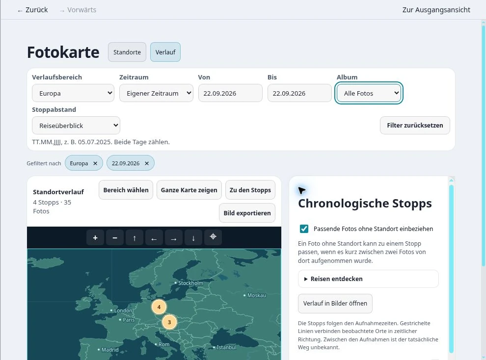

<a id="download-and-install"></a>

## Download und Installation

Wähle unter **Assets** das Paket für dein System. Zu den Installationspaketen gibt es SHA-256-Prüfsummen. [Aktuelle Version herunterladen](https://github.com/KaiPressmar/face-manager/releases/latest)

| System | Paket | Installation |
| --- | --- | --- |
| Windows 11 x64 | `FaceManager-Setup-X.Y.Z.exe` | Öffne den Installer. |
| Ubuntu 26.04 amd64 | `face-manager_X.Y.Z_amd64.deb` | Installiere die heruntergeladene Datei mit APT. |

Ersetze unter Ubuntu im Download-Ordner `X.Y.Z` durch die Version im Dateinamen. Für ein Update verwendest du denselben Befehl mit der neuen Datei.

```bash
sudo apt install ./face-manager_X.Y.Z_amd64.deb
```

Öffne Face Manager im Anwendungsmenü. Bei der ersten Gesichtserkennung lädt die Desktop-App das Gesichtsmodell bei Bedarf herunter.

Unter **Einstellungen → Updates → Jetzt nach Updates suchen** kannst du von Hand prüfen, ob eine neue Version verfügbar ist. Beim manuellen Update unter Windows wähle **Keep current data and update the application (recommended)**, falls der Installer nachfragt. Windows SmartScreen kann beim unsignierten Installer einen Hinweis anzeigen. [Versionshinweise](CHANGELOG.md)

Für Android 11 oder neuer kannst du die App aus dem Quellcode bauen. Die GitHub-Releases enthalten Installationspakete für Windows und Ubuntu. [Android-Bauanleitung](android/README.md)

<a id="first-import"></a>

## Erste Schritte

1. Öffne **Bilder hinzufügen** und wähle einen oder mehrere Bilderordner. Unter **Aktivitäten** siehst du den Fortschritt.
2. Öffne **Personen → Ohne Namen** und gib den passenden Gesichtern einen Namen. Unter **Vorschläge** kannst du mögliche Zuordnungen prüfen.
3. In **Bilder** kannst du nach Personen, Ordnern oder Alben filtern. Unter **Karte** findest du Fotos mit gespeicherten Aufnahmeorten.

Oben in der App öffnet **Hilfe** eine Anleitung, in der du ein Thema direkt auswählen kannst. Mit **Zurück** und **Vorwärts** kehrst du zu früheren Ansichten zurück. Beim Wechsel über die Seitenleiste bleiben deine zuletzt verwendeten Ansichten erhalten. **Zur Ausgangsansicht** bringt dich zu den Standardfiltern der aktuellen Seite.

Über **Schnellwechsel** oder **Strg+K** findest du Bereiche auch anhand von Suchbegriffen wie „Reise“ oder „Sicherung“.

<a id="app-tour"></a>

## Bebilderte Tour

Screenshots und Video zeigen Beispieldaten aus der App. Die Porträts und Reisefotos der ersten Demo wurden mit OpenAI erzeugt. [Älteres Bedienvideo mit englischen Texteinblendungen (ohne Ton)](docs/screenshots/face-manager-demo.mp4?raw=true)

<details>
<summary>Bilder, Galerie und Import</summary>

Wähle unter **Bilder hinzufügen** mehrere Ordner auf einmal aus. Öffne in **Bilder** ein Foto für die Vollbildgalerie. Dort findest du zugehörige Gesichter und die Speicherorte der Datei.

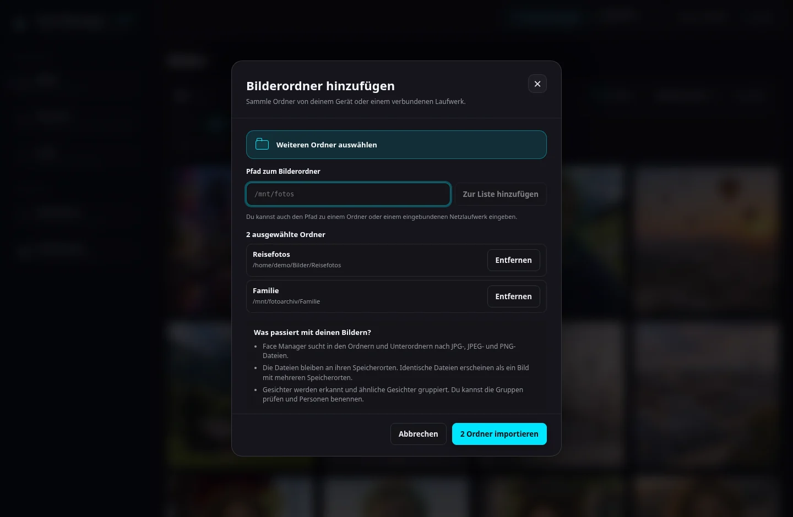


</details>

<details>
<summary>Personen und Dateinamen</summary>

Unter **Personen** vergleichst du vorgeschlagene Zuordnungen mit bereits benannten Gesichtern. Nach einer unterstützten lokalen Namenszuordnung oder Archivaktion kannst du die Änderung rückgängig machen und wiederholen. Fehlt ein Gesicht, öffne das Foto und wähle **Gesicht markieren**. Ziehe einen Rahmen auf und wähle die passende Person. Unter **Dateinamen** zeigt **Umbenennung prüfen** den aktuellen und den vorgesehenen Namen.


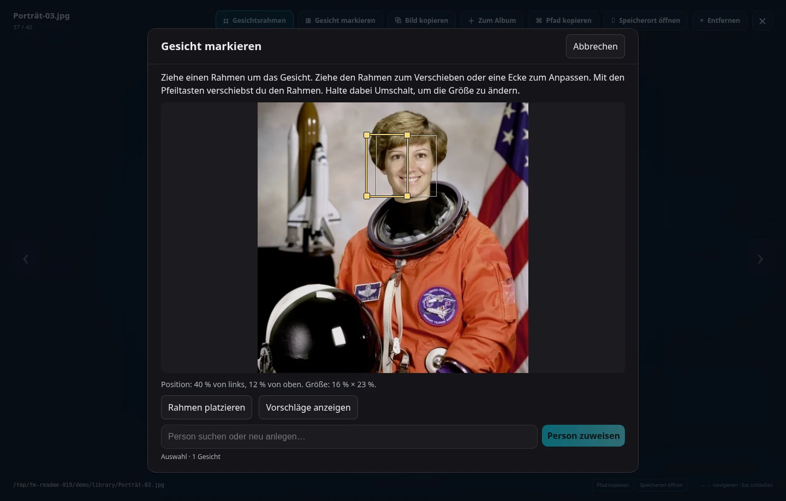

[Bildnachweis für das Porträt der NASA](https://scikit-image.org/docs/stable/api/skimage.data.html#skimage.data.astronaut)

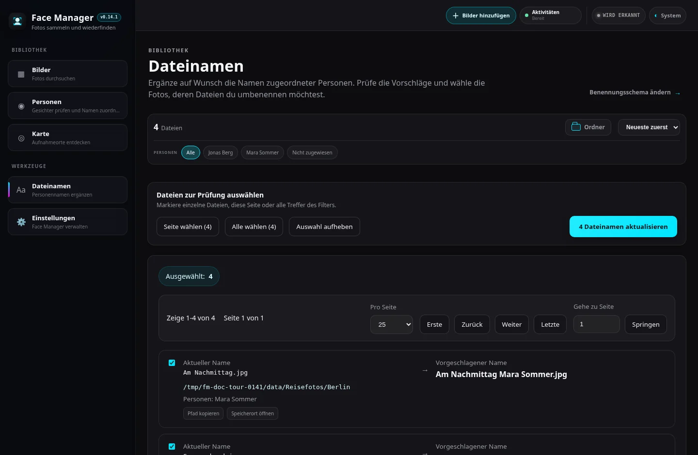

</details>

<details>
<summary>Fotokarte, Reiseverlauf und Alben</summary>

Kombiniere in **Karte** einen **Zeitraum** mit **Bereich wählen** oder wähle einen Aufnahmeort unter **Orte aus meinen Fotos**. Die Stile **Standard**, **Landschaft** und **Satellit** funktionieren offline. **Verlauf** zeigt die Stopps in zeitlicher Reihenfolge. Für kurze Wege wähle unter **Stoppabstand** den Modus **Stadt und Spaziergang**. Gestrichelte Linien verbinden die beobachteten Orte. Fotos ohne Standort, die zeitlich zu einem Stopp passen, sind gekennzeichnet und lassen sich ausblenden.

Unter **Reisen entdecken** kannst du einen Vorschlag ansehen, Reisetage auswählen und bei Bedarf An- oder Rückreise einblenden. Speichere die ausgewählten Fotos als Reisealbum und öffne es später über **Album** in **Bilder** oder **Karte**. Über **Zum Album hinzufügen** sammelst du weitere Fotos aus der Galerie oder der Karte.


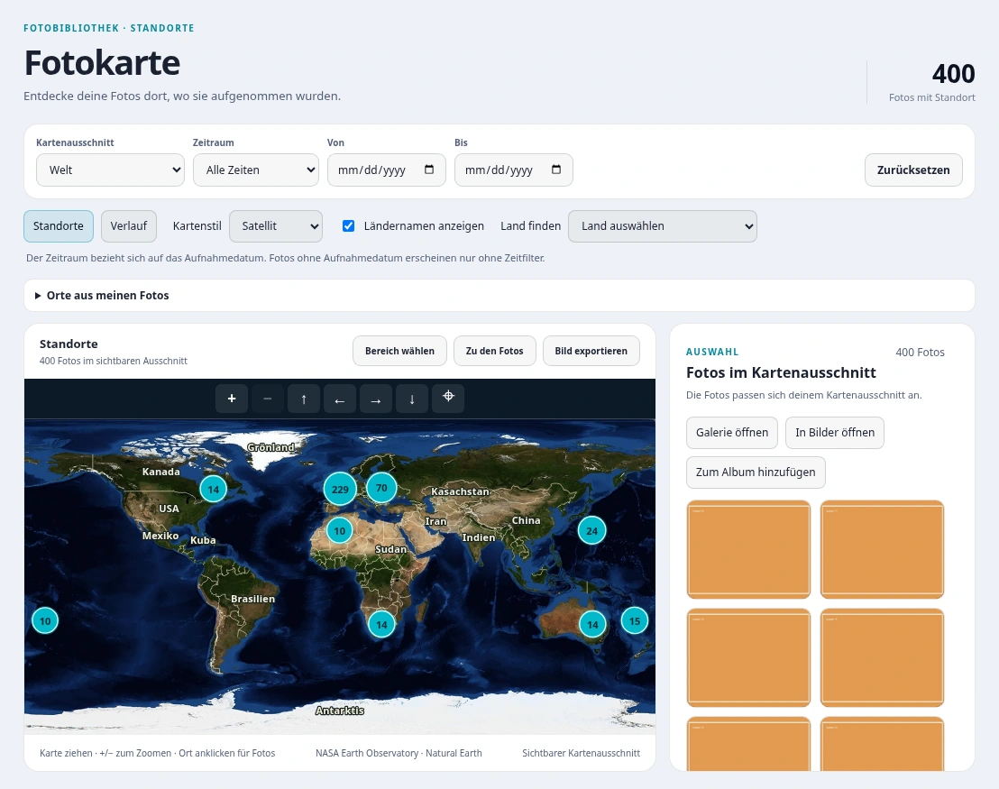


</details>

<details>
<summary>Fotobuchbild gestalten</summary>

Öffne in **Karte** die gewünschte Auswahl und wähle **Bild exportieren**. Passe Titel, Format, Druckauflösung, Farben und Kartenausschnitt an. Für eigene Bildmaße stehen Pixel und Millimeter zur Wahl. Unter **Route gestalten** kannst du Verkehrsmittel für einzelne Etappen wählen. Speichere eine Seite als PNG oder mehrere Seiten zusammen als ZIP. Mit **Entwurf im Album speichern** sicherst du die Gestaltung. Öffne später das Album und wähle erneut **Bild exportieren**.

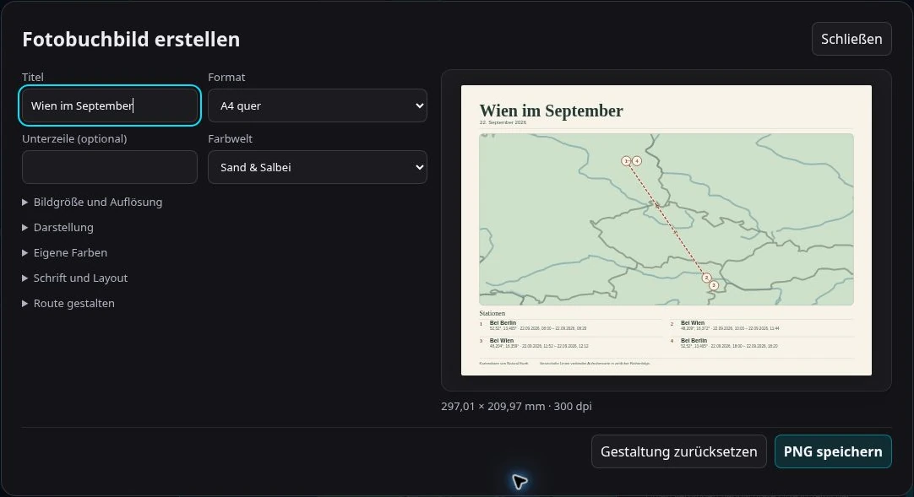

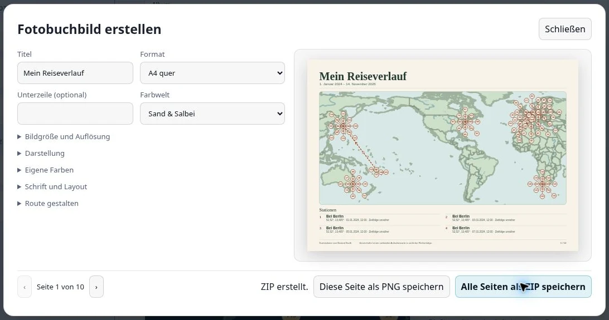

</details>

<details>
<summary>Hilfe, Aktivitäten und Hardware</summary>

Wähle unter **Hilfe** ein Thema. **Aktivitäten** zeigt laufende und abgeschlossene Aufgaben wie Import, Standortprüfung und Updates. In der Kopfleiste siehst du, ob die Gesichtserkennung den Prozessor (**CPU**) oder die Grafikkarte (**GPU**) nutzt. Einen Wechsel zum Prozessor zeigt die App als **CPU-Ersatzbetrieb** an. Nach der ersten Analyse findest du dort auf dem Computer **Hardware prüfen**.

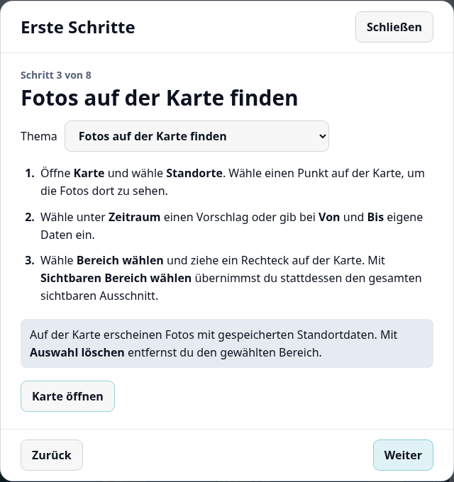

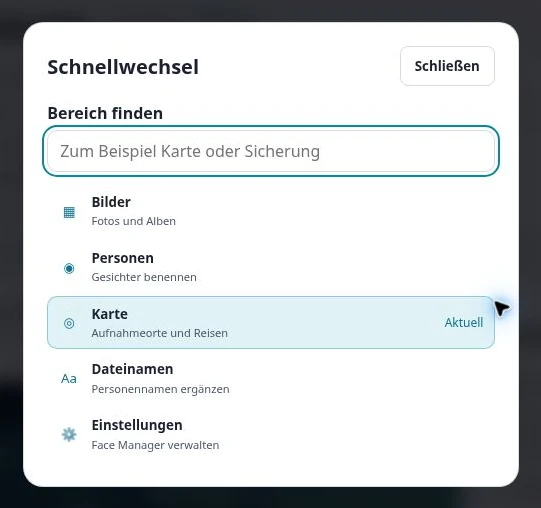

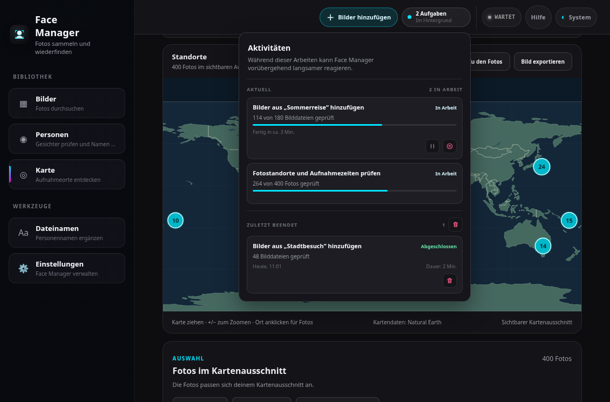

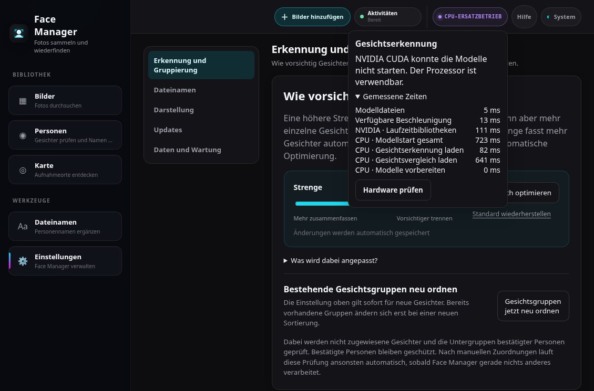

</details>

<details>
<summary>Einstellungen und gemeinsame Ordner</summary>

In **Einstellungen** findest du Erkennung, Dateinamen, Darstellung sowie **Daten und Wartung**. Dort erstellst du eine Sicherung und stellst die Größe des lokalen Vorschau-Speichers ein.

**Gemeinsame Ordner** lassen sich in einer Entwicklervorschau für den Abgleich von Zuordnungen über eine eingerichtete Freigabe nutzen. [Stand und Einrichtung der Vorschau](docs/shared-library-design.md)


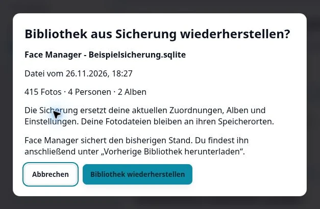

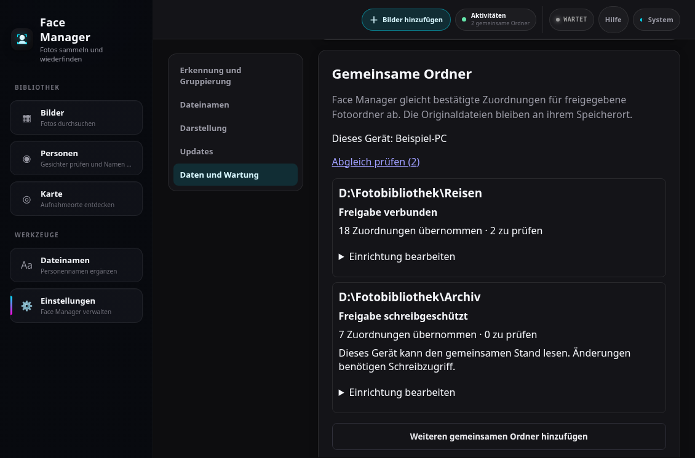

</details>

<a id="data-and-privacy"></a>

## Daten und Datenschutz

Die Fotoanalyse läuft auf deinem Gerät. Namen, Zuordnungen und Merkmale erkannter Gesichter speichert Face Manager in einer lokalen Bibliothek. Die Bibliothek verweist auf deine Fotoordner. Wenn du einen Ordner verschiebst, füge ihn am neuen Speicherort erneut hinzu.

Unter **Einstellungen → Daten und Wartung** kannst du die Bibliothek sichern oder eine frühere Sicherung wiederherstellen. Die Vorschau zeigt, wie viele Fotos, Personen und Alben in der gewählten Datei stehen. Nach der Bestätigung kannst du den vorherigen Stand herunterladen. Sichere deine Originalfotos separat.

Unter **Aussortierte Gesichter prüfen** findest du Hinweise aus früheren Sicherungen, falls ein eigentlich aussortiertes Gesicht wieder bei einer benannten Person erschienen ist. Du kannst auch eine eigene Sicherung derselben Bibliothek zum Vergleich hinzufügen. Übernimm nur Vorschläge, bei denen du das Gesicht wiedererkennst.

Karte und Reiseverlauf verwenden lokal mitgelieferte Karten- und Satellitendaten. Die optionale Update-Suche fragt GitHub nach neuen Versionen. [Kartendaten und Quellen](frontend/src/components/map/world-land.LICENSE.md) · [Datenaustausch in der Vorschau für gemeinsame Ordner](docs/shared-library-design.md)

<a id="run-from-source"></a>

## Aus dem Quellcode starten

Für Ubuntu ab 22.04 und WSL2 richtet das Setup die Entwicklungsumgebung ein.

```bash
git clone https://github.com/KaiPressmar/face-manager.git
cd face-manager
./scripts/setup-dev.sh
```

Starte im Projektordner `./scripts/dev-backend.sh` und in einem zweiten Terminal `npm --prefix frontend run dev`. Die Entwicklungs-API auf Port 8000 ist für vertrauenswürdige Netze vorgesehen. [Anwendung öffnen](http://localhost:5173) · [API-Dokumentation](http://localhost:8000/docs) · [Entwicklung und Beiträge](CONTRIBUTING.md)

<a id="build-desktop-installers"></a>

<details>
<summary>Tests und Desktop-Installer</summary>

Führe `./scripts/check-all.sh` aus, um Änderungen zu prüfen. Baue Installationspakete mit `./packaging/windows/build-release.ps1` unter Windows oder `./scripts/package-linux.sh` unter Ubuntu 26.04. [Voraussetzungen und Release-Prozess](CONTRIBUTING.md) · [Build-Konfiguration](.github/workflows/release.yml) · [Plan für Karte, Alben und Aktivitäten](docs/plans/photo-map-and-activities.md)

</details>
