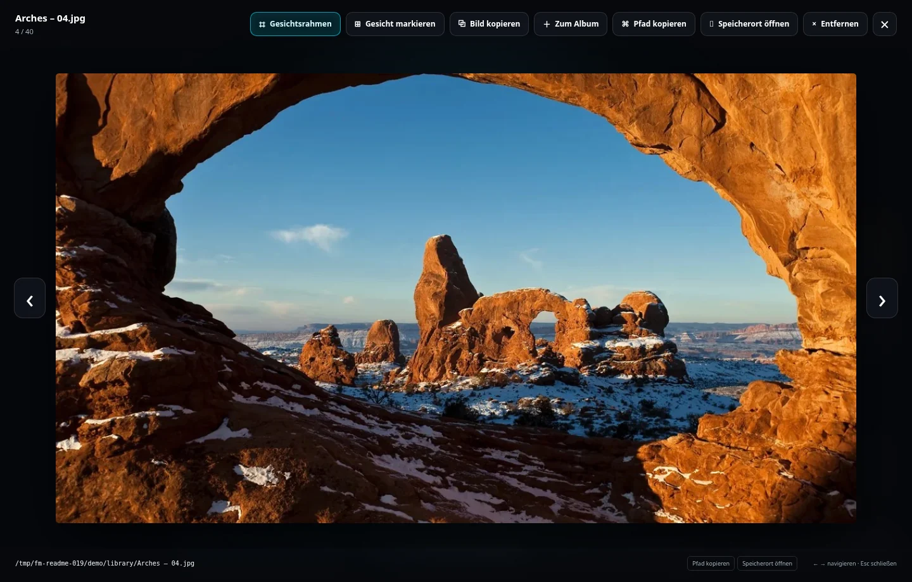
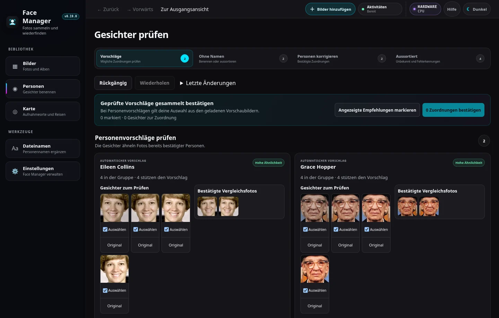
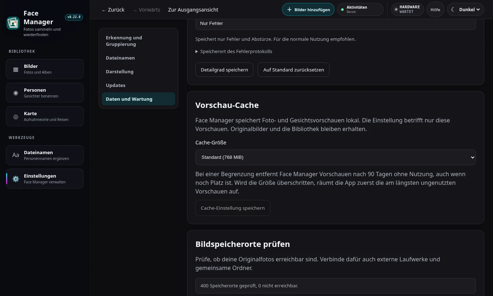

# Face Manager

Face Manager organizes your photo library on your own device. It groups similar faces so you can name people, find them across folders, and browse geotagged photos on an offline map. The library tracks your originals at their existing locations.

[Download](#download-and-install) · [First import](#first-import) · [App tour](#app-tour) · [Data and privacy](#data-and-privacy) · [Development](#run-from-source)

## Download and install

Download the package for your system under **Assets**. [Latest GitHub release](https://github.com/KaiPressmar/face-manager/releases/latest)

| System | Package | Installation |
| --- | --- | --- |
| Windows 11 x64 | `FaceManager-Setup-X.Y.Z.exe` | Open the installer. |
| Ubuntu 26.04 amd64 | `face-manager_X.Y.Z_amd64.deb` | Install the downloaded package with APT. |

From the Ubuntu download folder, replace `X.Y.Z` with the version in the filename. Use the same command with the new file to update.

```bash
sudo apt install ./face-manager_X.Y.Z_amd64.deb
```

Open **Face Manager** from your applications menu. On Ubuntu, the `face-manager` command also opens the app. The first desktop face-processing run downloads the InsightFace model if it is absent.

The Windows installer serves CPU and GPU systems. If you installed an older `-GPU` edition, download the current installer from GitHub once and select **Keep current data and update the application (recommended)**. Windows SmartScreen may warn about the unsigned installer. Each desktop package has a published SHA-256 checksum. [Release assets](https://github.com/KaiPressmar/face-manager/releases/latest)

### Desktop acceleration

With a supported graphics driver, Face Manager tries NVIDIA CUDA, then an available Intel GPU through OpenVINO, then the CPU. Ubuntu also needs the Intel OpenCL compute driver for Intel GPU acceleration. The app shows which processing mode it has selected after it loads the face model. To run the Ubuntu package on the CPU, use `FACE_MANAGER_CPU_ONLY=1 face-manager`.

## First import

1. Open **Bilder** (Photos) and select **Bilder hinzufügen** (Add photos). The empty library also offers **Bilderordner auswählen** (Choose photo folders).
2. Add one or more folders. The dialog offers native folder selection on the desktop. Ubuntu also accepts an absolute path to a local folder or mounted network share.
3. Start the import and follow it in **Aktivitäten** (Activity). Face Manager scans subfolders for JPEG and PNG files. Identical files share one library entry, with each source location recorded.
4. Open **Personen** (People) to name groups under **Ohne Namen** (Unnamed) and review suggestions under **Vorschläge** (Suggestions). The **Personen zuordnen** prompt in **Bilder** opens the unnamed groups directly.
5. Return to **Bilder** to browse by person or folder. Open **Karte** (Map) to see photos with GPS coordinates.

## App tour

These screenshots and the video were captured in the running Face Manager app. The portraits and travel scenes are AI-generated with OpenAI. Names, dates, and photo locations are demonstration data. [OpenAI image generation](https://developers.openai.com/api/docs/guides/image-generation)

The offline map uses public-domain map data from Natural Earth. [Natural Earth terms of use](https://www.naturalearthdata.com/about/terms-of-use/)

### Video walkthrough

Watch the main workflows in a short, captioned MP4. [Open or download the demo](docs/screenshots/face-manager-demo.mp4?raw=true)

[](docs/screenshots/face-manager-demo.mp4?raw=true)

### Photo library

**Bilder** lets you browse the full collection, filter by person or folder, and open a face label to review its group. Folder filters include photos in subfolders.

[Open the photo library screenshot at full size](docs/screenshots/photo-library.webp)

### Full-screen gallery

Open a photo to browse its neighbors, toggle face labels, and find its original file locations. When a source is temporarily unavailable, the gallery can show a locally cached preview and lets you retry loading the original.



### People review

**Personen** shows suggested matches alongside confirmed reference photos. Select the faces you want to assign, give an unnamed group a name, or correct an existing assignment. Suggestions are based on confirmed people in your library.



### Photo map

**Karte** shows photos with GPS coordinates. Zoom, pan, search for a country, select a region, and filter by capture date. Choose the landscape style or show country names in either style. Open a map selection in the full-screen gallery or use it to filter the Pictures page.

**Verlauf** groups dated photos into chronological stops. Open a stop to see only its photos. Stops show a nearby place and an approximate distance when a clear local match is available. Dashed lines connect observed photo locations. Gaps and uncertain times distinguish observations that cannot be placed in a reliable sequence. The map and journey work offline. An existing library may show more locations and more precise times as Face Manager reads the original files in the background.


### Filename suggestions

**Dateinamen** previews filenames that include confirmed person names. Review the proposed changes and choose which files to rename. The filename format is configurable in **Einstellungen** (Settings).


### Settings and maintenance

**Einstellungen** includes recognition settings, filename rules, appearance, updates, backups, and maintenance. In **Daten und Wartung**, you can set the limit for locally cached photo and face previews. **Ohne Grenze** disables automatic size and age cleanup, so the cache can keep growing on the device.



### Import photos

**Bilder hinzufügen** lets you collect folders before starting the import. **Aktivitäten** shows progress and lets you pause, resume, or cancel jobs. **Ordner erneut prüfen** queues the folder again from an eligible history entry. Previously processed photos are recognized by content.


## Data and privacy

Face Manager processes photos on your device and keeps library metadata, clusters, and face embeddings in local SQLite. Importing, browsing, and face review leave source files in place. The **Dateinamen** tool renames source files you explicitly select. Keep at least one source copy accessible to open an original, and re-import a folder after moving it to register the new paths.

Use **Einstellungen → Daten und Wartung → Sicherung erstellen** to back up the library and **Sicherung wiederherstellen** to restore it. Keep a separate backup of your source photos. The preview cache is stored locally and can be rebuilt from available originals.

| Environment | Default library data |
| --- | --- |
| Windows desktop | `%LOCALAPPDATA%\FaceManager\database.sqlite` |
| Ubuntu desktop | `$XDG_DATA_HOME/face-manager/database.sqlite`, or `~/.local/share/face-manager/database.sqlite` |
| Source checkout | `backend/db/database.sqlite` |

If the default Ubuntu data directory has no database, the package can reuse an existing `~/.face-manager` library.

The desktop app binds to localhost. The development API listens on `0.0.0.0:8000` for WSL and remote development. Both APIs expose unauthenticated endpoints, so keep these ports on a trusted network. Use an authenticated proxy if you deliberately provide access outside that boundary.

## Run from source

On Ubuntu 22.04+ or WSL2, the setup script installs and validates the Python and Node.js environments and dependencies. The script is safe to rerun.

```bash
git clone https://github.com/KaiPressmar/face-manager.git
cd face-manager
./scripts/setup-dev.sh
```

Start the FastAPI backend and the Vite frontend in separate terminals.

```bash
# Terminal 1, from the repository root
./scripts/dev-backend.sh
```

```bash
# Terminal 2, from the repository root
cd frontend
npm run dev
```

- [App at localhost:5173](http://localhost:5173)
- [Interactive API documentation at localhost:8000/docs](http://localhost:8000/docs)
- [OpenAPI schema](http://localhost:8000/openapi.json)

Use `./scripts/setup-dev.sh --help` for setup options, including `--cpu`, `--gpu`, `--dry-run`, and `--skip-system-packages`. To diagnose source CUDA setup, run `nvidia-smi` and check for `CUDAExecutionProvider` after activating `backend/.venv`. CUDA use also depends on successful model initialization.

```bash
source backend/.venv/bin/activate
python -c 'import onnxruntime as ort; print(ort.get_available_providers())'
```

The development frontend proxies `/api` to port `8000`. Set `FACE_MANAGER_VITE_API_TARGET` to use another backend. For a deliberately separate frontend using `VITE_API_BASE`, configure `FACE_MANAGER_ALLOWED_ORIGINS` with the exact frontend origins, including schemes and ports. To change the number of import preparation workers, set `FACE_MANAGER_IMPORT_WORKERS` before starting the backend.

<details>
<summary>Manual setup, VS Code, and build dependencies</summary>

Use Python 3.10+, Node.js 20+, npm 10+, and a C/C++ toolchain for `hnswlib` when setting up manually.

```bash
python3 -m venv backend/.venv
source backend/.venv/bin/activate
python -m pip install --upgrade pip setuptools wheel
python -m pip install -r backend/requirements.txt 'onnxruntime>=1.18,<2'
npm --prefix frontend ci
```

If `hnswlib` needs build headers, install `build-essential` and `python3-dev` on Ubuntu. For missing OpenCV shared libraries, install `libgl1` and the distribution’s GLib runtime package. In VS Code, press `F5` and choose **Full Stack: Debug**.

</details>

### Development and release checks

```bash
./scripts/check-all.sh
```

The optional Chromium smoke suite runs against an isolated temporary library. Install Playwright outside the repository to run it locally.

```bash
npm install --prefix /tmp/face-manager-ui-tools playwright
PLAYWRIGHT_BROWSERS_PATH=/tmp/face-manager-ui-browsers /tmp/face-manager-ui-tools/node_modules/.bin/playwright install chromium
NODE_PATH=/tmp/face-manager-ui-tools/node_modules PLAYWRIGHT_BROWSERS_PATH=/tmp/face-manager-ui-browsers ./scripts/check-ui.sh
```

Use `UI_SMOKE_SCREENSHOT_DIR` to retain screenshots and `UI_SMOKE_API_PORT` / `UI_SMOKE_WEB_PORT` to override the default ports `8194` / `5194`.

Build Windows installers on Windows with CPython 3.12 x64, Node.js 20+, and Inno Setup 6.

```powershell
./packaging/windows/build-release.ps1
```

Build and verify the `.deb` on Ubuntu 26.04 amd64 with Python 3.14 headers and venv, a C/C++ toolchain, and Node.js 20+. The release workflow lists the GTK, WebKitGTK, OpenCL, and other system packages used for the build and runtime check. [Ubuntu build dependencies](.github/workflows/release.yml)

```bash
./scripts/package-linux.sh
./scripts/package-linux.sh --check "dist/face-manager_$(cat VERSION)_amd64.deb"
```

Feature work goes through `develop`. Releases move from `develop` to `main` through a pull request. See the complete contribution and release workflows and the user-facing version history. [Contributing](CONTRIBUTING.md) · [Changelog](CHANGELOG.md)

### How face matching works

InsightFace detects faces and creates 512-dimensional embeddings. Face Manager normalizes those vectors and uses cosine distance with an `hnswlib` index to find candidate matches. It checks nearby faces, group cohesion, and competing matches before grouping, and uses confirmed assignments to propose names for eligible faces. Pose, lighting, blur, and similar-looking people can affect results. Review uncertain or mixed groups in **Personen**. [Face model](backend/models/face_model.py) · [Clustering code](backend/models/clustering.py)

The desktop code uses FastAPI, SQLite, and ONNX Runtime, with a React and TypeScript frontend. Windows packages use PyInstaller and Inno Setup. Ubuntu packages use Debian tooling. GitHub Actions runs validation and publishes release assets. [Backend](backend/) · [Frontend](frontend/) · [Release workflow](.github/workflows/release.yml)
