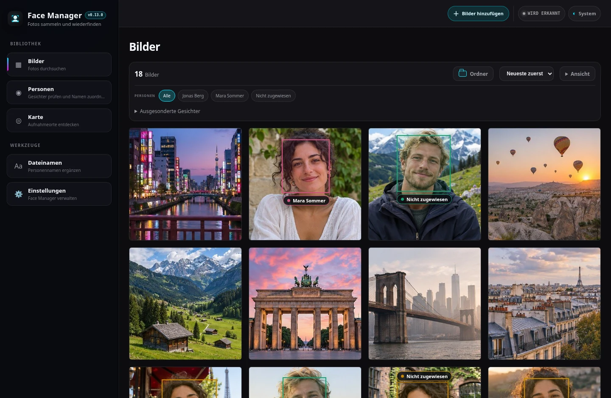

# Face Manager

Face Manager is a local photo organizer with face clustering for Windows and
Ubuntu Linux. It scans your existing photo folders, groups similar faces, and
lets you review and name people across your library. Browse photos by person,
folder, or GPS location.
Face Manager references your original files in place and keeps its library on
your device.

## Download and install

Download the file for your system under **Assets** on the
[latest GitHub release](https://github.com/KaiPressmar/face-manager/releases/latest).

| System | Installer | How to install |
| --- | --- | --- |
| **Windows 11 x64** | `FaceManager-Setup-X.Y.Z.exe` | Open the downloaded installer. |
| **Ubuntu 26.04 amd64** | `face-manager_X.Y.Z_amd64.deb` | Install the package with APT. |

On Ubuntu, open a terminal in the download folder and replace `X.Y.Z` with the
version in the filename:

```bash
sudo apt install ./face-manager_X.Y.Z_amd64.deb
```

Open **Face Manager** from the applications menu after installation. On Ubuntu,
you can also run `face-manager` in a terminal. The first desktop face-processing
run needs internet access if the InsightFace model is not already cached.
To update on Ubuntu, download the newer `.deb` and run the same APT command with
the new filename.

The shared Windows installer and the Ubuntu package are available once the
release includes their listed assets. Older releases may show separate Windows
CPU and GPU installers. To upgrade from the old `-GPU` installer, download the
shared `.exe` and choose to keep your data when prompted.

### Desktop acceleration

Each desktop installer works on CPU and can use a supported GPU with the
appropriate driver. Face Manager tries NVIDIA CUDA first, then an available
Intel GPU through OpenVINO, then CPU. On Ubuntu, an Intel GPU also requires an
OpenCL compute driver. Windows SmartScreen may warn about the unsigned
installer. The release provides a SHA-256 checksum for each desktop package.

### Android

The separate Android app processes photos on the phone and includes its face
models. A release offers an Android download when its signed
`FaceManager-Android-X.Y.Z.apk` appears under **Assets**.
[Android installation and build instructions](android/README.md).

> [!IMPORTANT]
> Face Manager is designed for trusted, local use. Images and face data are not
> uploaded to a hosted service.

## Screenshots

Screenshots of Face Manager using a synthetic demo library.

### Photo library



### People review


### Photo map


## Why Face Manager?

Large photo collections are easy to accumulate and difficult to explore. Face Manager
adds a people-first view without forcing you to reorganize, duplicate, or upload the
original files.

- **Keep your existing folder structure** — imports reference source files instead of
  copying them into the project.
- **Find people across folders** — browse assigned people, face clusters, and nested
  folder selections from one interface.
- **Avoid duplicate processing** — content hashes identify identical images even when
  they appear at multiple locations.
- **Stay in control** — assignments, clusters, embeddings, and library metadata remain
  in your local SQLite database.

## Highlights

| Area | What it does |
| --- | --- |
| Face analysis | Detects faces with InsightFace and creates normalized 512-dimensional embeddings |
| Clustering | Groups similar faces incrementally using cosine distance and an HNSW neighbor index |
| People | Assigns clusters to named people and uses those assignments as conservative matching guidance |
| Photo browser | Displays a masonry gallery, face overlays, and full-screen navigation |
| Photo map | Shows geotagged photos on an offline map with location and date filters |
| Folder filtering | Searches and selects multiple nested folders at any discovered level |
| Import pipeline | Queues imports, resumes interrupted jobs, and skips already processed content |
| Storage | Persists library metadata in SQLite while leaving source images untouched |

## Tech Stack

- **Backend:** Python, FastAPI, SQLite, InsightFace, ONNX Runtime, hnswlib
- **Frontend:** React, TypeScript, Vite
- **Desktop packaging:** PyInstaller and Inno Setup for Windows, Debian packages for Ubuntu
- **Automation:** GitHub Actions for validation and desktop releases

## Run from source

### Ubuntu 22.04+ or WSL2

The setup script installs missing system packages, Node.js 20 when needed, the Python
environment, backend dependencies, and frontend dependencies. It then validates the
backend and builds the frontend.

```bash
git clone https://github.com/KaiPressmar/face-manager.git
cd face-manager
./scripts/setup-dev.sh
```

Start the application in two terminals:

```bash
# Terminal 1 — API
./scripts/dev-backend.sh
```

```bash
# Terminal 2 — web interface
cd frontend
npm run dev
```

Open `http://localhost:5173`.

The first image import downloads the InsightFace `buffalo_l` model. Later runs use the
cached model.

### Setup Options

```text
--cpu                   Force CPU-only installation
--gpu                   Require NVIDIA GPU installation
--skip-system-packages  Skip apt and Node.js installation
--dry-run               Print actions without changing the system
--help                  Show all options
```

Examples:

```bash
./scripts/setup-dev.sh --dry-run
./scripts/setup-dev.sh --cpu
./scripts/setup-dev.sh --gpu
```

The script is safe to rerun and installs only missing or incompatible dependencies.
It never modifies source images or the SQLite library.

## Using Face Manager

1. Open the **People** view.
2. Select **Ordner hinzufügen**.
3. Choose a folder or paste a Windows/Linux path.
4. Start the import and follow its progress.
5. Review generated clusters and assign them to people.
6. Browse by person, folder, or image and open photos in the full-screen gallery.

Supported image types:

- `.jpg`
- `.jpeg`
- `.png`

The importer scans recursively. Selecting a folder in **Ordnerfilter** includes images
from all descendants.

### Explore photos on the world map

Open **Karte** in the library sidebar to explore photos by their GPS capture
location. Map and matching photos appear side by side on larger screens. Zoom
and pan to explore clusters, select a rectangular region, and combine it with
an inclusive capture-date range or a date shortcut. Remove individual filter
chips to broaden the results. Open any photo, including photos without detected
faces, in the full-screen viewer. Map controls also work with the keyboard.

The map works offline and never sends image coordinates to a map provider.
Existing photos are indexed in the background when the application starts;
new imports are indexed automatically. Photos without valid GPS coordinates
remain available in **Bilder** but cannot appear on the map. Date filters use
the capture date stored in the photo, not its import or file-modification date;
photos without a capture date appear only when no date filter is applied.
Original files must remain accessible for metadata indexing.

### How duplicate images are handled

Images are identified by a SHA-256 hash of their contents. Importing the same image
from multiple folders creates one canonical library entry with multiple source
locations. Face detection is performed only once for that content.

At least one source copy must remain accessible because Face Manager references the
original files rather than storing replacements.

## Import Queue and Recovery

Imports are persisted in SQLite and processed by a shared background worker so the
face model and clustering index remain consistent.

```text
POST   /api/imports             Queue a folder import
GET    /api/imports             List active, queued, and recent jobs
DELETE /api/imports/{job_id}    Cancel or remove a job
```

Queued jobs can be removed immediately. Running jobs stop safely after the current
image. If the backend restarts, unfinished jobs return to the queue in FIFO order and
already committed images are skipped.

## Optional NVIDIA GPU setup from source

Verify that the NVIDIA driver is available:

```bash
nvidia-smi
```

After installing the normal backend requirements, replace the CPU runtime with the GPU
runtime:

```bash
source backend/.venv/bin/activate
python -m pip uninstall -y onnxruntime onnxruntime-gpu
python -m pip install 'onnxruntime-gpu[cuda,cudnn]>=1.21,<2'
```

Confirm that ONNX Runtime sees CUDA:

```bash
python -c "import onnxruntime as ort; print(ort.get_available_providers())"
```

The output must contain `CUDAExecutionProvider`. Face Manager selects CUDA when it is
available and otherwise falls back to CPU execution.

To override the automatic import preparation worker count:

```bash
FACE_MANAGER_IMPORT_WORKERS=3 ./scripts/dev-backend.sh
```

## Manual Development Setup

Requirements:

- Linux or WSL2
- Python 3.10+
- Node.js 20+
- npm 10+
- A C/C++ compiler for `hnswlib`

### Backend

```bash
python3 -m venv backend/.venv
source backend/.venv/bin/activate
python -m pip install --upgrade pip setuptools wheel
python -m pip install -r backend/requirements.txt
python -m pip install 'onnxruntime>=1.18,<2'
```

### Frontend

```bash
cd frontend
npm ci
cd ..
```

### Development URLs

- Frontend: `http://localhost:5173`
- API: `http://localhost:8000`
- Interactive API documentation: `http://localhost:8000/docs`
- OpenAPI schema: `http://localhost:8000/openapi.json`

Vite proxies `/api` to the FastAPI backend on port `8000`. Set
`FACE_MANAGER_VITE_API_TARGET` before starting Vite to proxy to another backend URL.

## VS Code

The repository includes recommended extensions, tasks, and debug configurations for
Python, TypeScript, formatting, GitHub Actions, backend/frontend development, and
compound full-stack debugging.

Press `F5` and select **Full Stack: Debug**, or use **Terminal > Run Task** for setup,
servers, validation, GitHub configuration, and release helpers.

## Data and Backups

During development, the SQLite database is created at:

```text
backend/db/database.sqlite
```

Back it up with:

```bash
cp backend/db/database.sqlite backend/db/database.backup.sqlite
```

Database files are ignored by Git. Removing the database while the backend is stopped
creates a fresh library on the next launch and permanently removes local assignments,
clusters, and embeddings.

Windows desktop installations store the database under:

```text
%LOCALAPPDATA%\FaceManager\database.sqlite
```

The Ubuntu package uses `$XDG_DATA_HOME/face-manager` or
`~/.local/share/face-manager` when `XDG_DATA_HOME` is unset. If that location
has no database, the launcher reuses an existing `~/.face-manager` library.

## Validation

Run the local equivalent of the GitHub Actions checks:

```bash
./scripts/check-all.sh
```

This validates release metadata, compiles and tests the backend, type-checks the
frontend, and creates a production build.

For the complete contribution, branch, CI, and release workflow, see
[CONTRIBUTING.md](CONTRIBUTING.md).

### Browser workflow checks

The optional browser suite creates its own temporary photo library and local
servers. It checks map filtering and request races, existing library workflows,
and narrow-window layouts without touching your library. Install Playwright
outside the repository, then run:

```bash
npm install --prefix /tmp/face-manager-ui-tools playwright
PLAYWRIGHT_BROWSERS_PATH=/tmp/face-manager-ui-browsers /tmp/face-manager-ui-tools/node_modules/.bin/playwright install chromium
NODE_PATH=/tmp/face-manager-ui-tools/node_modules PLAYWRIGHT_BROWSERS_PATH=/tmp/face-manager-ui-browsers ./scripts/check-ui.sh
```

Optional: set `UI_SMOKE_SCREENSHOT_DIR` to retain screenshots, or override
`UI_SMOKE_API_PORT` / `UI_SMOKE_WEB_PORT` if the default ports 8194 / 5194 are in use.

## Build desktop installers

Build the installer on Windows with CPython 3.12 x64, Node.js 20+, and Inno Setup 6:

```powershell
./packaging/windows/build-release.ps1
```

Build and check the `.deb` on an Ubuntu 26.04 amd64 build host with Python 3.14 headers
and venv, build tools, GTK 3 and WebKitGTK 4.1 introspection, `desktop-file-utils`, and
Node.js 20+:

```bash
./scripts/package-linux.sh
./scripts/package-linux.sh --check "dist/face-manager_$(cat VERSION)_amd64.deb"
```

## Project Structure

```text
backend/
  app.py                 FastAPI routes
  config.py              Local database configuration
  db/                    SQLite schema and generated database
  models/                Face detection and clustering
  services/              Import pipeline and storage queries
frontend/
  src/                   React application
  package.json           Frontend scripts and dependencies
.github/workflows/
  ci.yml                 Pull request and branch validation
  release.yml            Release and desktop artifact publication
packaging/windows/       Windows bundle and installer configuration
packaging/linux/         Ubuntu package and runtime launcher
scripts/                 Setup, validation, and release helpers
CHANGELOG.md             Curated user-facing release notes
CONTRIBUTING.md          Development and release workflow
VERSION                  Canonical application version
```

## Release Model

Development follows a two-branch model:

- `develop` is the integration branch for ongoing work.
- `main` contains released code only.
- Feature branches start from and merge into `develop`.
- Releases move from `develop` to `main` through a pull request.

Face Manager uses semantic versioning. Prepare a release with:

```bash
./scripts/release-version.sh patch
./scripts/release-version.sh minor
./scripts/release-version.sh major
# or
./scripts/release-version.sh 1.2.0
```

See [CHANGELOG.md](CHANGELOG.md) for user-facing changes and
[CONTRIBUTING.md](CONTRIBUTING.md) for the complete release checklist.

## Troubleshooting

### Start the Ubuntu package in CPU mode

```bash
FACE_MANAGER_CPU_ONLY=1 face-manager
```

### `hnswlib` fails to install

```bash
sudo apt install -y build-essential python3-dev
python -m pip install --upgrade pip setuptools wheel
```

### InsightFace or OpenCV reports a missing shared library

```bash
sudo apt install -y libgl1 libglib2.0-0
```

### Source installation uses the CPU despite an NVIDIA GPU

Check `nvidia-smi`, then inspect the available providers:

```bash
source backend/.venv/bin/activate
python -c "import onnxruntime as ort; print(ort.get_available_providers())"
```

Only `onnxruntime-gpu` should be installed for GPU mode.

### The frontend cannot reach the API

Confirm that FastAPI is running on port `8000`, Vite is running on port `5173`, and
`http://localhost:8000/docs` opens successfully.

### Images disappear after moving a source folder

Face Manager stores absolute source paths. Move the images back or re-import them from
the new location.

## Security and Privacy Scope

Face Manager is designed for trusted local environments. The packaged desktop app
binds to localhost. The development backend script listens on `0.0.0.0` for WSL
and remote development, which can make it reachable on the LAN. The desktop and
development API have no authentication. Keep their ports on trusted networks and
use an authenticated proxy before allowing access from an untrusted network.

The bundled frontend and Vite proxy use same-origin requests by default. If a
separate frontend deliberately sets `VITE_API_BASE`, set
`FACE_MANAGER_ALLOWED_ORIGINS` on the backend to a comma-separated list of exact
frontend origins, such as `http://localhost:5173,https://photos.example.com`.
Include each scheme and any non-default port. The Android app limits browser
access to its authenticated local WebView session.

## How Face Analysis and Clustering Work

This section describes the current implementation rather than face recognition in the
abstract. Face Manager does not infer a person's name from an image. It detects faces,
calculates similarity vectors, groups likely matches, and lets the user attach names to
those groups.

### 1. Image preparation and duplicate detection

Before model inference, the importer recursively discovers supported files and hashes
their contents with SHA-256. An image whose content was already processed reuses the
existing database record, even when it appears under another path. Only new or changed
content is decoded into an RGB NumPy array and passed to the face model.

### 2. Face detection

Face Manager loads the InsightFace `buffalo_l` model pack with only its detection and
recognition modules enabled. The detector is prepared with a `1024 × 1024` detection
canvas. InsightFace returns a bounding box for every detected face:

```text
(x1, y1, x2, y2) → (x, y, width, height)
```

The bounding box is stored with the image record and is used for face overlays and
thumbnails. Detection and embedding inference run through ONNX Runtime. On desktop,
the same models can run through NVIDIA CUDA, Intel GPU with OpenVINO, or CPU.

### 3. Face embeddings

For every detected face, the recognition model produces a 512-dimensional floating
point embedding. The embedding is not a name or a human-readable description. It is a
position in a learned feature space where images of visually similar faces tend to be
closer together.

Each vector is L2-normalized before it is stored or compared:

```text
normalized_embedding = embedding / ||embedding||₂
```

Normalization makes the vector length equal to one, so similarity can be compared with
a dot product. Face Manager uses cosine distance:

```text
cosine_similarity = a · b
cosine_distance   = 1 - (a · b)
```

A distance near `0` means that two embeddings point in almost the same direction and
are therefore very similar. Larger distances indicate less similarity. The configured
distance threshold is a decision boundary, not a probability or percentage.

### 4. Fast neighbor search with HNSW

All stored embeddings are added to an `hnswlib` index configured for cosine distance.
HNSW, or Hierarchical Navigable Small World, is an approximate nearest-neighbor graph.
It avoids comparing every new face with every stored face, which would become expensive
for large libraries.

When a new embedding arrives, Face Manager queries up to 64 nearby embeddings. HNSW
returns candidate IDs and cosine distances; the application then applies additional
checks before reusing a cluster. Approximate search is therefore used to find promising
neighbors, not to make the final identity decision by itself.

### 5. Matching an already named person

Clusters assigned to a person provide supervised evidence for later imports. Face
Manager keeps representative appearance prototypes for each named person and combines
two signals:

- the distance to that person's nearest prototype;
- the average distance to the closest labeled neighbor embeddings.

A person match is accepted only when the local neighborhood supports it:

- at least two close neighbors vote for the same person;
- that person receives at least 60% of the close-neighbor votes;
- the combined prototype and neighbor score remains below the distance threshold;
- the best candidate is separated from the runner-up by a safety margin.

If those checks disagree or the result is ambiguous, the algorithm declines the person
match instead of forcing an assignment.

### 6. Matching an unnamed cluster

When no confident named-person match exists, the embedding is compared with unassigned
clusters. A cluster is eligible only when both of these checks pass:

- the nearest member is within the distance threshold;
- the embedding is also within the threshold of the cluster centroid.

For clusters with at least three members, Face Manager additionally requires multiple
supporting neighbors and at least 60% local agreement. If two candidate clusters score
too similarly, neither is selected. A new cluster is created when no candidate passes
all gates.

This local-plus-global check prevents a single unusual photo from attaching a face to a
cluster whose overall shape does not fit.

### 7. Incremental behavior

Clustering happens incrementally during import. Each accepted embedding is registered
in memory and then added to the HNSW index, so later faces in the same import can use it
as evidence. Existing embeddings, cluster IDs, and person assignments are loaded from
SQLite when the shared clustering resource is initialized.

Incremental clustering is intentionally conservative but can depend on import order. A
face imported before better examples are available may initially remain in a small or
standalone cluster.

### 8. Cluster cleanup and rebuilding

The clustering module includes post-processing for rebuilding and improving groups:

- **Small-cluster consolidation:** clusters with one or two movable faces may be merged
  into a larger cluster only when all members agree on the same target, multiple nearby
  samples support it, and no close runner-up exists.
- **Heterogeneous-cluster splitting:** broad clusters are measured against their
  normalized centroid. The 95th-percentile radius is used so isolated bad crops are
  tolerated while a sizeable second identity can still be detected.
- **Recursive two-way split:** a broad cluster is tentatively separated from two distant
  seeds using repeated cosine-based assignments. Both child groups must contain enough
  samples and their centers must have meaningful separation before the split is kept.
- **Stable similarity ordering:** faces inside a cluster can be ordered along a nearest-
  neighbor path, beginning at a peripheral sample, to make visual review more coherent.

These passes are deliberately stricter than a simple connected-components or
single-linkage approach. Single-linkage can join two people through a chain of marginal
matches; Face Manager instead checks centroids, local support, robust cluster radius,
and candidate margins.

### 9. Threshold calibration

The distance threshold can be calibrated from faces that the user has already assigned
to people. Positive examples come from the same person and, where available, the same
appearance subcluster. Different people provide negative examples.

The calibration mirrors the runtime cohesion checks by considering both nearby samples
and group centroids. Each person contributes equally to the score so people with many
photos do not dominate the result. When two thresholds perform equally, the lower and
therefore safer threshold is preferred to reduce accidental merges.

### 10. Practical limitations

Embedding similarity can be affected by pose, age, lighting, blur, occlusion, camera
quality, very small faces, and visually similar relatives. The system is designed to
assist organization, not to make authoritative identity claims.

Manual review remains part of the workflow: users can assign names, move incorrect
faces, split mixed groups, or leave uncertain clusters unassigned. The conservative
matching rules intentionally favor additional clusters over silently combining
 different people.
