# Face Manager

Face Manager ordnet deine Fotos auf deinem Gerät. Du kannst Gesichtern Namen geben, Aufnahmeorte auf der Offline-Karte finden und Reisen als Album oder Fotobuchbild festhalten.

[Download](#download-und-installation) · [Erste Schritte](#erste-schritte) · [Bebilderte Tour](#bebilderte-tour) · [Datenschutz](#daten-und-datenschutz) · [Quellcode](#aus-dem-quellcode-starten)

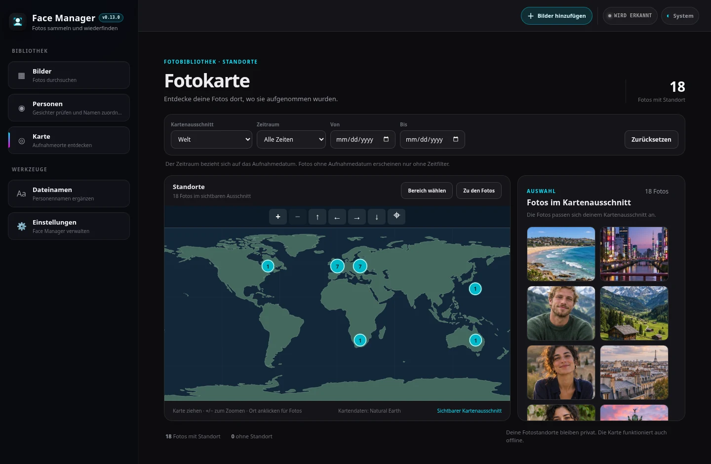

<a id="download-and-install"></a>

## Download und Installation

Wähle unter **Assets** das Paket für dein System. Zu den Installationspaketen gibt es SHA-256-Prüfsummen. [Aktuelle Version herunterladen](https://github.com/KaiPressmar/face-manager/releases/latest)

| System | Paket | Installation |
| --- | --- | --- |
| Windows 11 x64 | `FaceManager-Setup-X.Y.Z.exe` | Öffne den Installer. |
| Ubuntu 26.04 amd64 | `face-manager_X.Y.Z_amd64.deb` | Installiere die heruntergeladene Datei mit APT. |

Ersetze unter Ubuntu im Download-Ordner `X.Y.Z` durch die Version im Dateinamen. Für ein manuelles Update schließt du zuerst Face Manager und verwendest denselben Befehl mit der neuen Datei.

```bash
sudo apt install ./face-manager_X.Y.Z_amd64.deb
```

Öffne Face Manager im Anwendungsmenü. Bei der ersten Gesichtserkennung lädt die Desktop-App das Gesichtsmodell bei Bedarf herunter.

Unter **Einstellungen → Updates → Jetzt nach Updates suchen** kannst du prüfen, ob eine neue Version verfügbar ist. Wähle **Update herunterladen** und anschließend **Update installieren**. Unter Ubuntu schließt sich Face Manager und du bestätigst die Installation im Terminal. Falls dein System den Start der Installation aus der App nicht unterstützt, erreichst du das Paket über **GitHub öffnen**.

Beim manuellen Update unter Windows wähle **Keep current data and update the application (recommended)**, falls der Installer nachfragt. Windows SmartScreen kann beim unsignierten Installer einen Hinweis anzeigen. [Versionshinweise](CHANGELOG.md)

Für Android 11 oder neuer kannst du die App aus dem Quellcode bauen. Die GitHub-Releases enthalten Installationspakete für Windows und Ubuntu. [Android-Bauanleitung](android/README.md)

<a id="first-import"></a>

## Erste Schritte

1. Öffne **Bilder hinzufügen** (in sehr schmalen Fenstern **+ Bilder**) und wähle einen oder mehrere Bilderordner. Unter **Aktivitäten** siehst du den Fortschritt.
2. Öffne **Personen → Prüfen → Ohne Namen**, wähle eine Gesichtsgruppe und gib den passenden Gesichtern einen Namen. Unter **Vorschläge** kannst du mögliche Zuordnungen prüfen.
3. In **Bilder** kannst du nach Personen, Ordnern oder Alben filtern. Unter **Karte** findest du Fotos mit gespeicherten Aufnahmeorten.

Unter **Hilfe** kannst du direkt ein Thema auswählen. Mit **Zurück** und **Vorwärts** kehrst du zu früheren Ansichten zurück. Beim Wechsel zwischen den Bereichen bleiben deine zuletzt verwendeten Ansichten erhalten. **Zur Ausgangsansicht** bringt dich zu den Standardfiltern der aktuellen Seite. In schmalen Fenstern findest du **Dateinamen** und **Einstellungen** unter **Mehr**.

<a id="app-tour"></a>

## Bebilderte Tour

Die Screenshots zeigen Face Manager im Modus **Dunkel**. Die Landschaftsaufnahmen stammen vom U.S. National Park Service. [Bildnachweise zu den Nationalparkfotos](docs/screenshots/photo-credits.md)

Die Porträts und Reisefotos im älteren Bedienvideo wurden mit OpenAI erzeugt. [Älteres Bedienvideo mit englischen Texteinblendungen (ohne Ton)](docs/screenshots/face-manager-demo.mp4?raw=true)

<details>
<summary>Bilder, Galerie und Import</summary>

Wähle unter **Bilder hinzufügen** mehrere Ordner auf einmal aus. In **Bilder** kannst du die Auswahl eingrenzen. In kleinen Fenstern öffnest du dazu **Filter und Sortierung**. Öffne ein Foto für die Vollbildgalerie. Dort findest du zugehörige Gesichter und die Speicherorte der Datei.


</details>

<details>
<summary>Personen und Gesichtsgruppen</summary>

Unter **Personen** findest du die bereits benannten Personen. Über **Prüfen** öffnest du die Aufgaben für Gesichter, deren Zuordnung noch offen ist.

<details>
<summary>Personenverzeichnis, Profil und Verwaltung</summary>

Suche eine Person nach Namen und öffne ihr Profil. Dort siehst du ihre Fotos. **Zuordnungen korrigieren** öffnet die Gesichter dieser Person. Unter **Person verwalten** kannst du ihren Namen ändern, sie mit einem anderen Eintrag zusammenführen oder sie aus dem Verzeichnis entfernen. Vor dem Zusammenführen oder Entfernen siehst du, wohin die zugeordneten Gesichter wechseln.

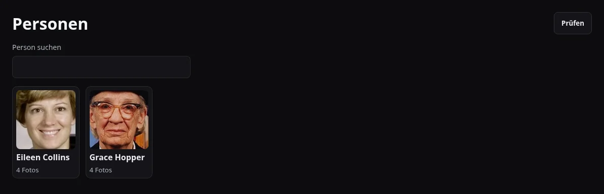

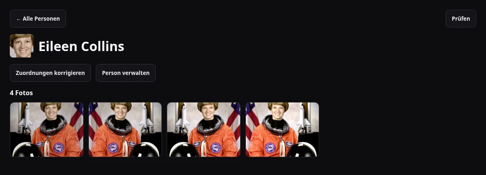

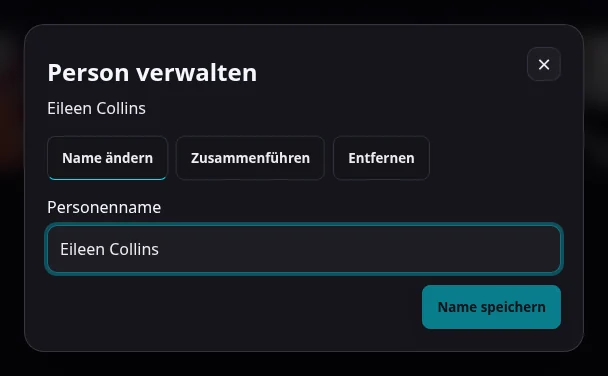

</details>

<details>
<summary>Vorschläge</summary>

Öffne einen Vorschlag, um die Gesichter mit bereits bestätigten Fotos zu vergleichen. Bestätige die markierte Auswahl mit **Gesichter zuordnen**. Unter **Weitere Aktionen** kannst du die Gesichtsgruppe öffnen oder den Vorschlag verwerfen.

Mit **Mehrere auswählen** kannst du passende Empfehlungen gemeinsam bestätigen.


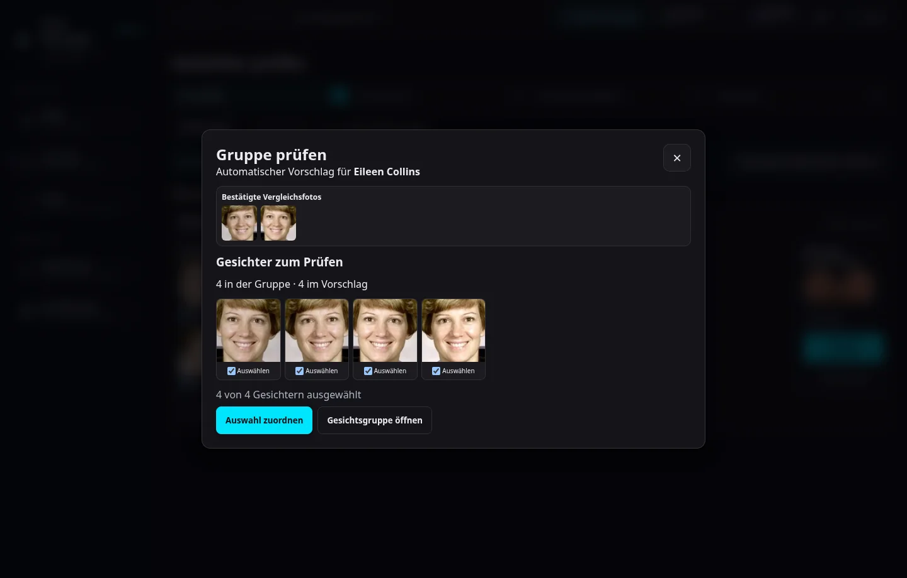

</details>

<details>
<summary>Ohne Namen</summary>

Wähle eine Gruppe und ordne ihr eine Person zu. Markiere bei gemischten Gruppen zuerst die passenden Gesichter. Über **Aussortieren oder lösen** findest du weitere Gruppenaktionen. In schmalen Fenstern kehrst du mit **Zur Gruppenliste** zur Auswahl zurück.

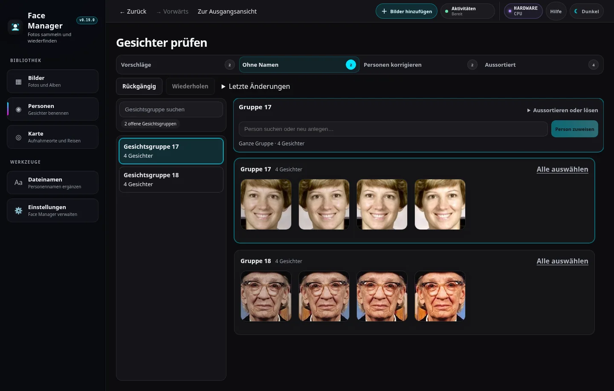

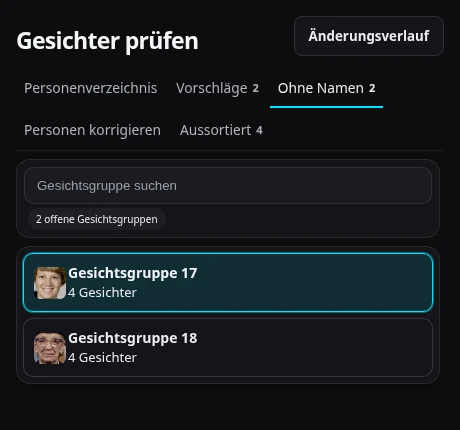

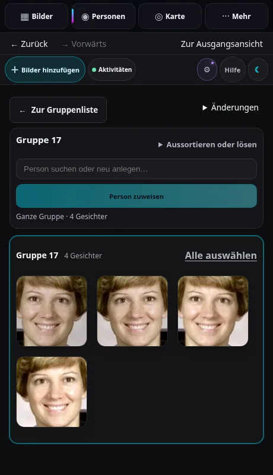

</details>

<details>
<summary>Personen korrigieren</summary>

Öffne im Profil **Zuordnungen korrigieren** oder wähle im Prüfbereich **Personen korrigieren**, um zwischen Personen und Gruppen zu wechseln. Markiere falsch zugeordnete Gesichter und weise sie einer anderen Person zu. Über die weiteren Aktionen kannst du die markierten Gesichter auch wieder zur Prüfung vorlegen.

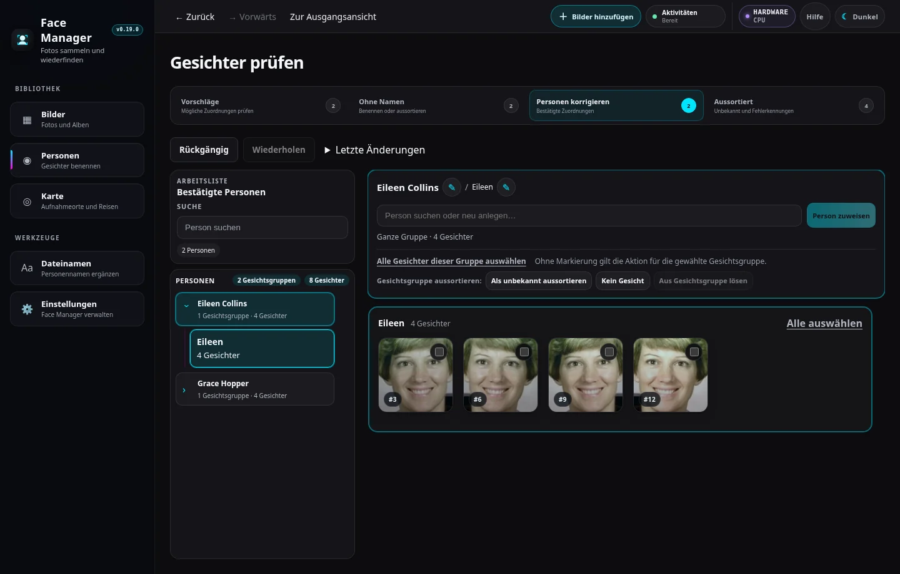

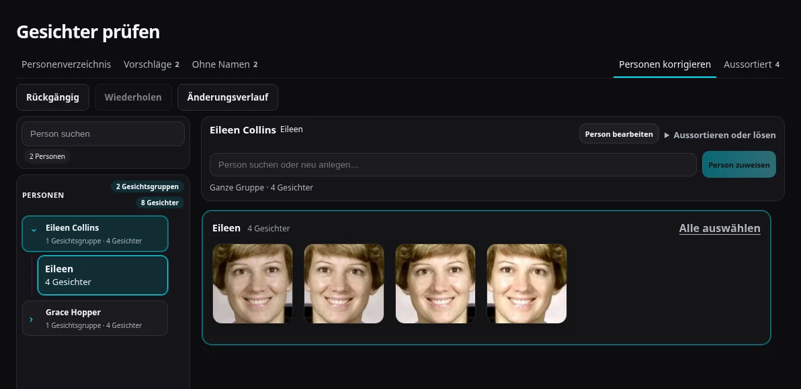

</details>

<details>
<summary>Aussortiert</summary>

Öffne **Unbekannte Personen** für aussortierte Gesichter oder **Keine Gesichter** für Fehlerkennungen. Mit **Erneut prüfen** legst du ausgewählte Treffer wieder unter **Ohne Namen** vor.

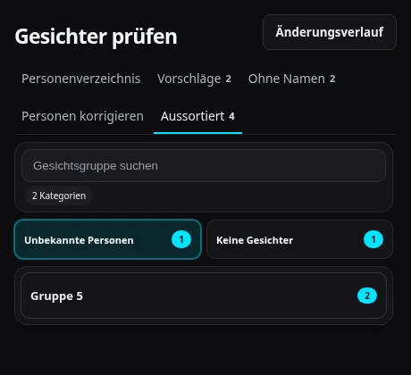

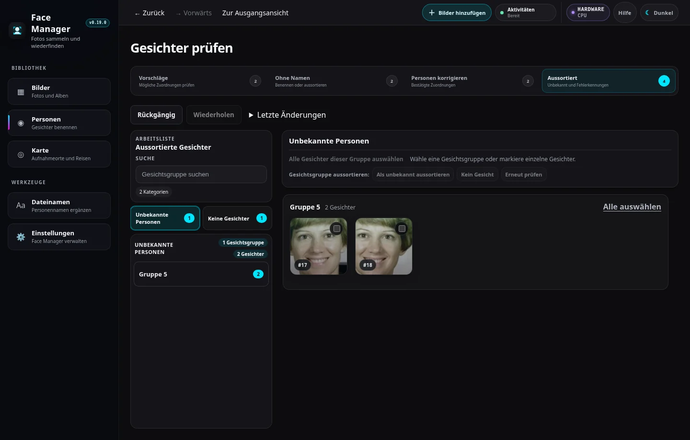

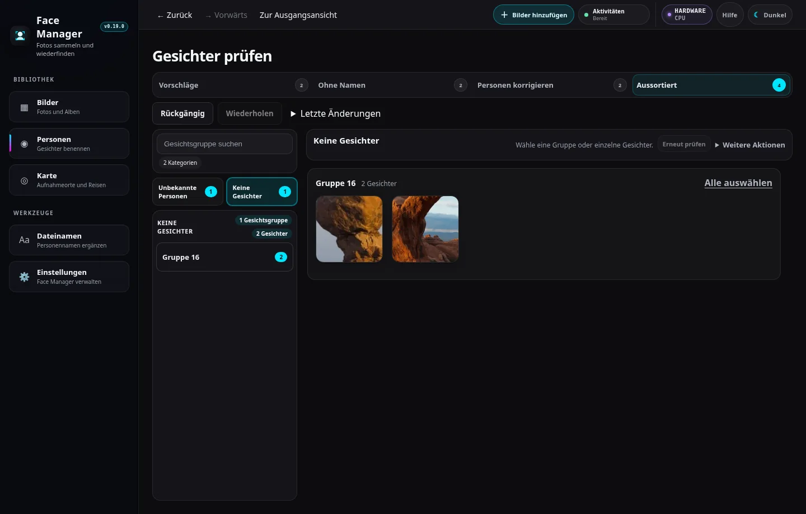

</details>

<details>
<summary>Abgleich prüfen</summary>

Wenn du einen gemeinsamen Ordner eingerichtet hast, kannst du hier abweichende Zuordnungen prüfen. Vergleiche die Bildausschnitte und wähle bei einer beschreibbaren Freigabe **Übernehmen** unter der passenden Entscheidung. Mit **Zur Fallliste** lässt du den Fall offen.

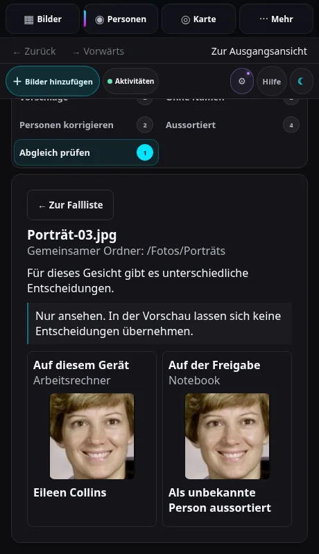

</details>

<details>
<summary>Änderungsverlauf und Gesichter manuell markieren</summary>

Im **Änderungsverlauf** siehst du kürzlich ausgeführte Aktionen. Unterstützte Änderungen an der lokalen Bibliothek kannst du mit **Rückgängig** zurücknehmen und mit **Wiederholen** erneut ausführen.

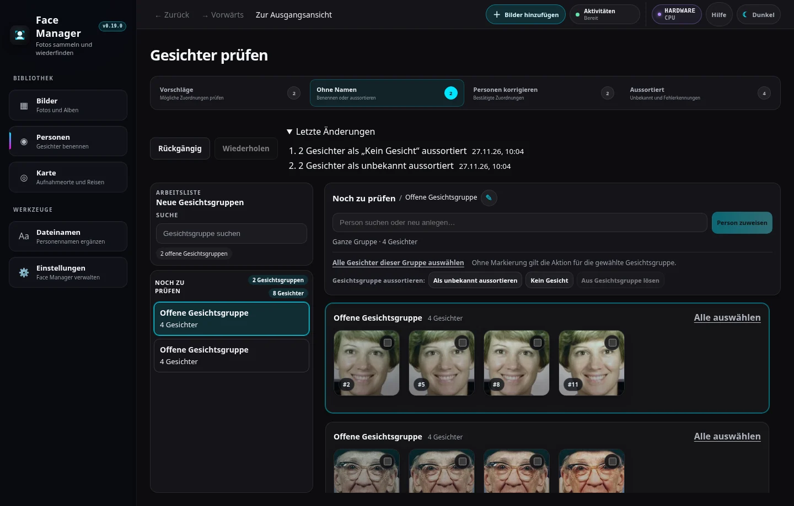

Fehlt ein Gesicht, öffne das Foto und wähle **Gesicht markieren**. Ziehe einen Rahmen auf und wähle die passende Person.


</details>

Die Beispielporträts stammen von der NASA und der U.S. Navy. [NASA-Porträt in scikit-image](https://scikit-image.org/docs/stable/api/skimage.data.html#skimage.data.astronaut) · [Grace Hopper in den Matplotlib-Beispieldaten](https://github.com/matplotlib/matplotlib/blob/main/lib/matplotlib/mpl-data/sample_data/grace_hopper.jpg)

</details>

<details>
<summary>Dateinamen</summary>

Unter **Dateinamen** zeigt **Umbenennung prüfen** den aktuellen und den vorgesehenen Namen.


</details>

<details>
<summary>Fotokarte, Reiseverlauf und Alben</summary>

### Fotos eines Ortes aus einem bestimmten Jahr ansehen

Öffne **Karte → Standorte** und suche unter **Orte aus meinen Fotos** nach einem Aufnahmeort. Im Beispiel gibt es in Moab Aufnahmen aus drei Jahren. Wähle **2025 · 3 Fotos**, um den Ort und das Aufnahmejahr gemeinsam zu filtern. Unter **Zeitraum** kannst du auch alle Fotos eines Aufnahmejahrs anzeigen oder eigene Daten eingeben.

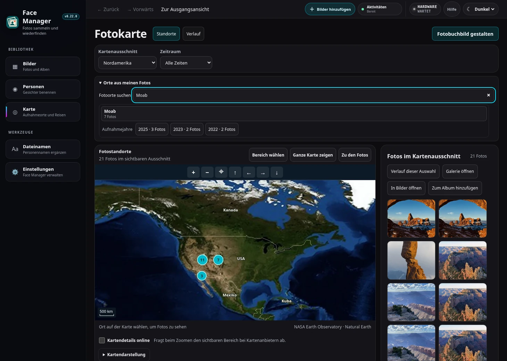

Die aktiven Filter stehen oberhalb der Karte. Mit **Fotoorte auf Karte zeigen** zentrierst du die Karte auf die Fotoauswahl. **Verlauf dieser Auswahl** öffnet den Verlauf für denselben Bereich und Zeitraum. Mit **Bereich wählen** kannst du auch einen eigenen Bereich aufziehen.

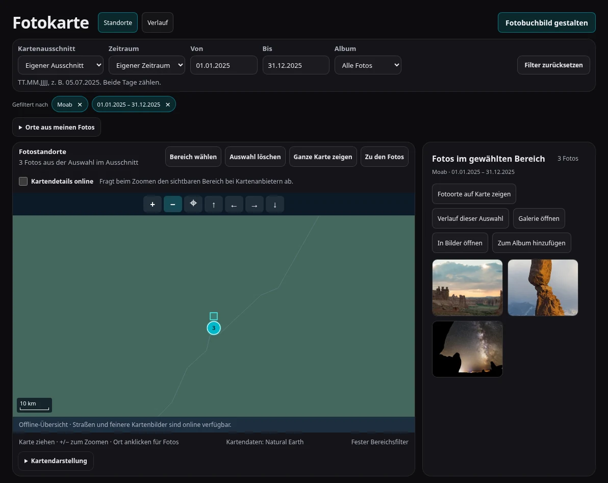

### Wiederkehrende Stopps und einzelne Reisen finden

**Verlauf** ordnet die Stopps nach Aufnahmezeit. Eine Markierung mit **×4** steht beispielsweise für vier Stopps am selben Kartenausschnitt. Öffne die Markierung und wähle in der Liste den gewünschten Besuch nach Datum. **Zur Stoppliste** bringt dich zurück zur Auswahl. Für kurze Wege gibt es unter **Stoppabstand** die Option **Stadt und Spaziergang**. Fotos ohne Standort, die zeitlich zu einem Stopp passen, sind gekennzeichnet und lassen sich ausblenden.

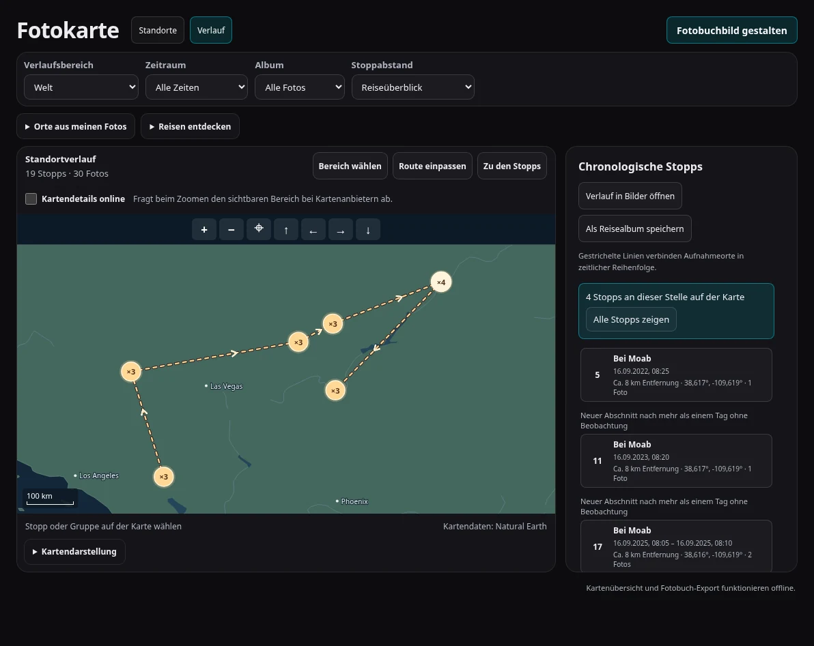

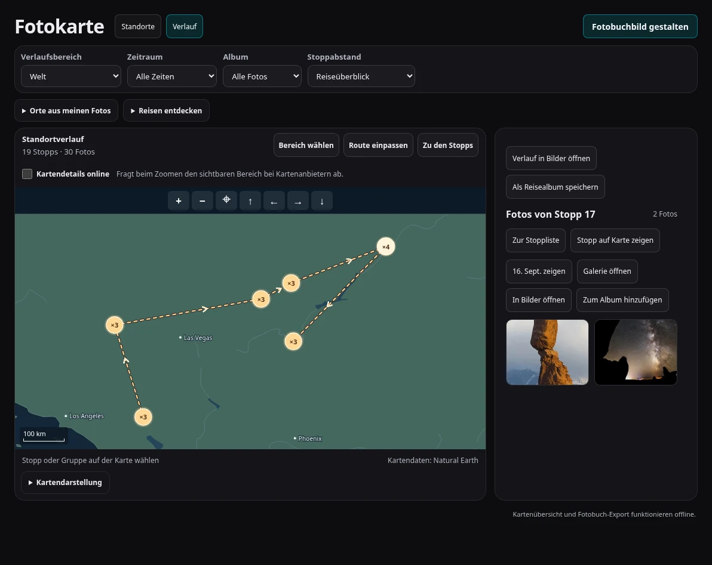

Öffne **Reisen entdecken**, um eine Reise nach Ort und Datum auszuwählen. Bei vielen Vorschlägen kannst du die Liste über **Reisen suchen** eingrenzen. Du kannst einen Reisetag wählen und bei Bedarf An- oder Rückreise einbeziehen. **Route einpassen** bringt alle Stopps der aktuellen Auswahl wieder ins Blickfeld. Speichere die Auswahl bei Bedarf als Reisealbum. Du findest das Reisealbum später in **Bilder → Alben** oder unter **Album** in der Karte. Mit **Zum Album hinzufügen** sammelst du weitere Fotos aus Galerie oder Karte.

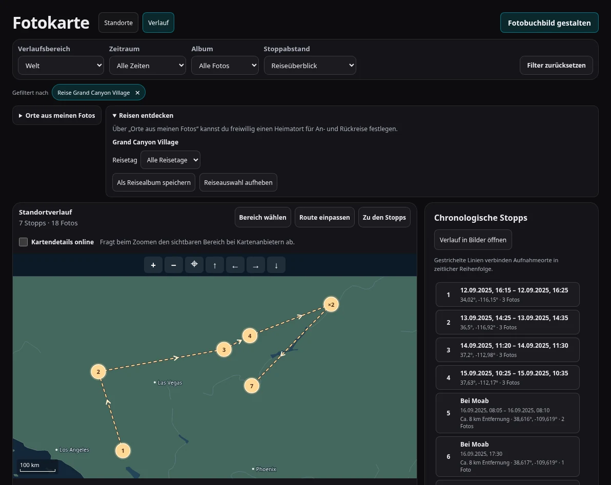

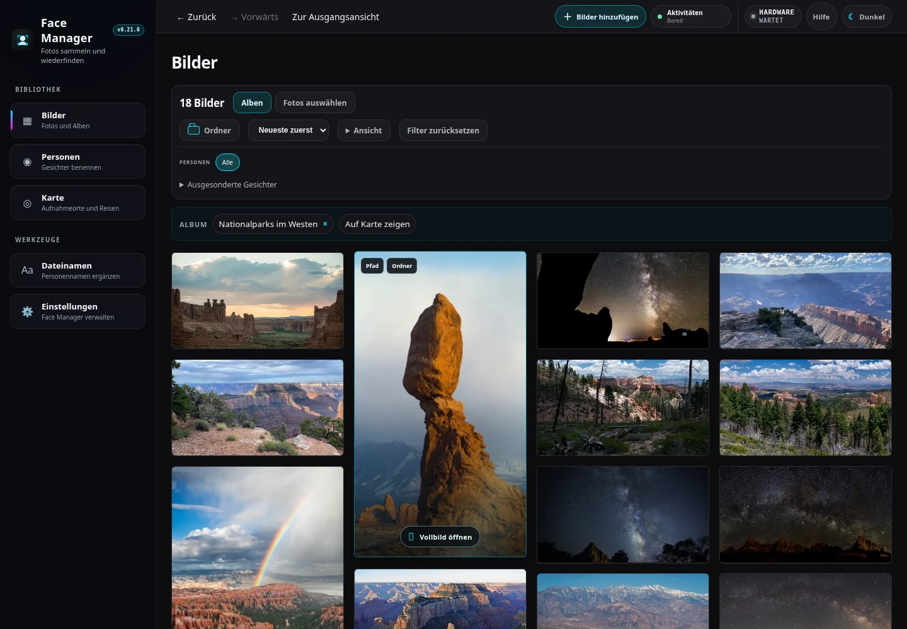

### Karte in einem kleinen Fenster oder mit mehr Details nutzen

In kleinen Fenstern wechselst du zwischen **Karte** und **Fotos** oder **Stopps**. Den Zeitraum stellst du unter **Kartenfilter** ein. **Fotobuchbild gestalten** ist in beiden Ansichten direkt erreichbar.

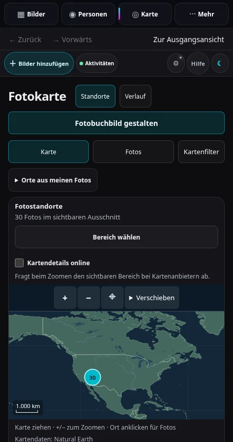

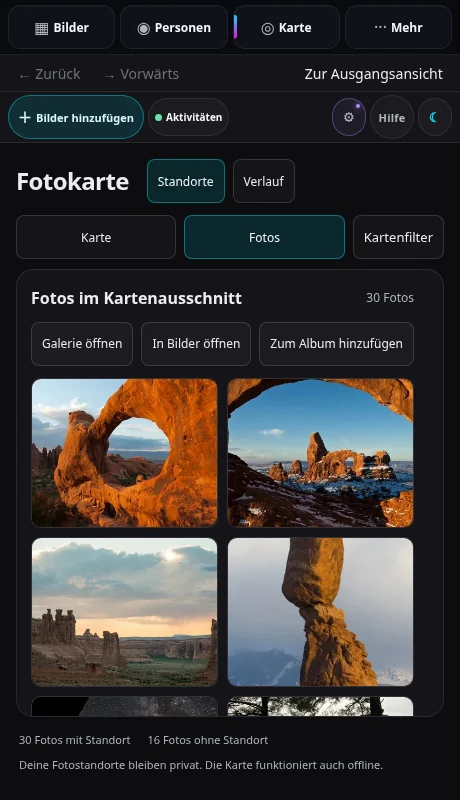

Die Offline-Übersicht gibt es unter **Kartendarstellung** in den Stilen **Standard**, **Landschaft** und **Satellit**. Aktiviere **Kartendetails online**, um beim Zoomen Straßen, Gebäude und feinere Gelände- oder Satellitenbilder zu laden. Nutze **+** oder einen Doppelklick in der Karte. Die Satellitendetails haben eine Auflösung von etwa zehn Metern pro Pixel. Straßen und Gebäudekonturen stammen aus der Straßenkarte.

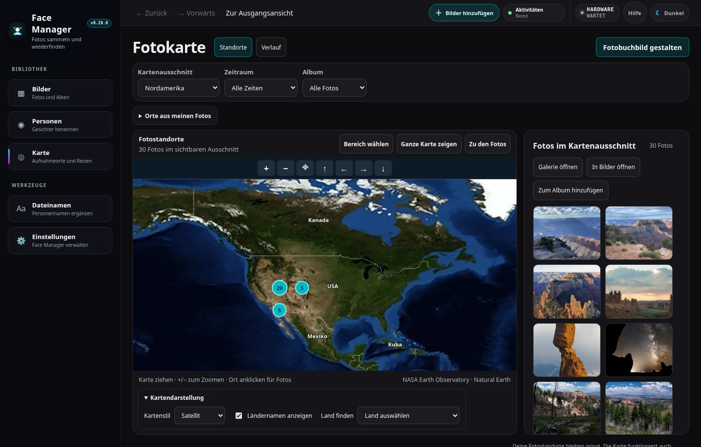

</details>

<details>
<summary>Fotobuchbild gestalten</summary>

### Format und Layout wählen

Wähle in **Karte** die gewünschten Fotos oder eine Reise und klicke auf **Fotobuchbild gestalten**. Stelle unter **Format** die Maße deiner Fotobuchseite ein. Es gibt A4 in Hoch- und Querformat, zwei Quadratformate und **Eigene Größe** für Maße in Millimetern oder Pixeln. Die Vorschau zeigt die Druckgröße, Auflösung und Pixelmaße. Im Beispiel ist die Seite 30 × 30 cm groß und auf 300 dpi eingestellt.

Unter **Layout** liefert **Karte auf einer Seite** eine einzelne Seite mit Platz für einen Titel. **Randlose Karte** füllt die gesamte Bildfläche mit der Karte. Für Reisen bietet **Karte mit Stoppliste** Platz für eine nummerierte Liste.

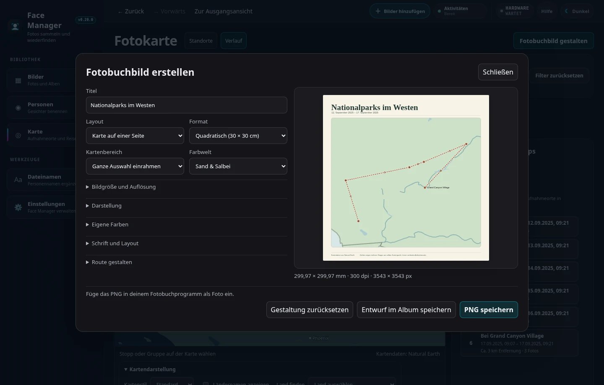

### Ausschnitt und Beschriftung gestalten

Wähle **Ganze Auswahl einrahmen**, um alle ausgewählten Stopps einzubeziehen. Mit **Sichtbarer Kartenausschnitt** übernimmst du den Ausschnitt aus der Karte. Unter **Ausschnitt anpassen** kannst du den Ausschnitt mit **Zoom** und den Pfeilen in der Vorschau ändern. Die Angabe unter der Vorschau zeigt, wie viele Stopps oder Fotos im Bild liegen. **Ausschnitt zurücksetzen** stellt die ursprüngliche Rahmung wieder her.

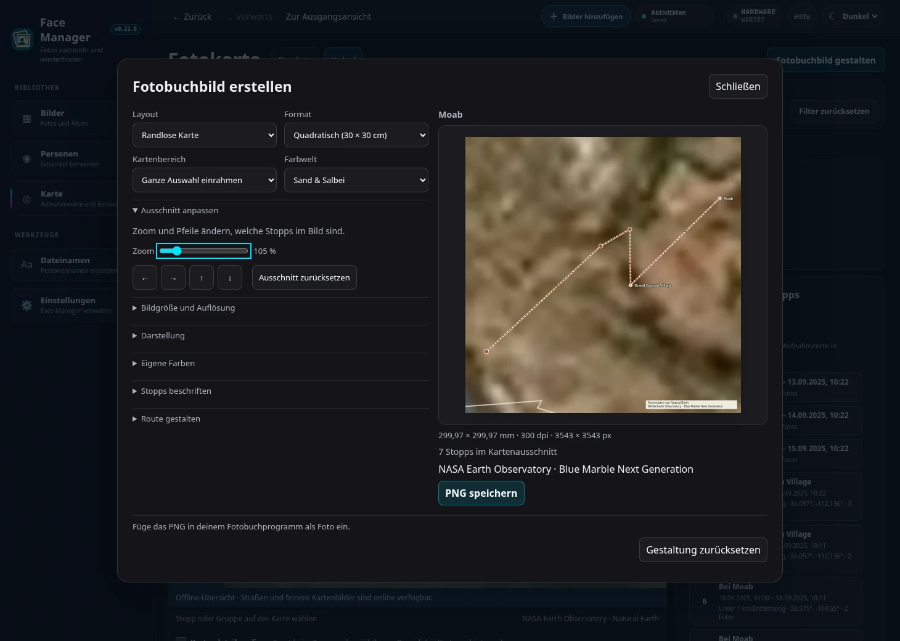

Unter **Darstellung** kannst du Kartenstil, Markierungen, Ortsnamen und Verbindungslinien einstellen. Mit **Stopps beschriften** gibst du einzelnen Reisestopps eigene Ortsnamen. Unter **Route gestalten** lassen sich Verkehrsmittel für einzelne Etappen eintragen. Der Export verwendet die Offline-Karte.

### Als PNG oder ZIP speichern

Wähle **PNG speichern** und füge die Datei in deinem Fotobuchprogramm als Bild ein, etwa in CEWE. Wenn die Stoppliste mehrere Seiten umfasst, blättere in der Vorschau und speichere die aktuelle Seite über **Diese Seite als PNG speichern**. **Alle Seiten als ZIP speichern** bündelt die einzelnen PNG-Dateien. Über **Entwurf im Album speichern** kannst du die Gestaltung eines Reisealbums später wieder öffnen.

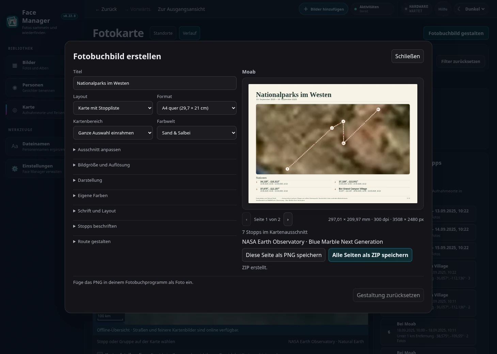

</details>

<details>
<summary>Hilfe, Aktivitäten und Hardware</summary>

Wähle unter **Hilfe** ein Thema. **Aktivitäten** zeigt laufende und abgeschlossene Aufgaben wie Import, Standortprüfung und Updates. In der Kopfleiste siehst du, ob die Gesichtserkennung den Prozessor (**CPU**) oder die Grafikkarte (**GPU**) nutzt. Einen Wechsel zum Prozessor zeigt die App als **CPU-Ersatzbetrieb** an. Nach der ersten Analyse findest du dort auf dem Computer **Hardware prüfen**.

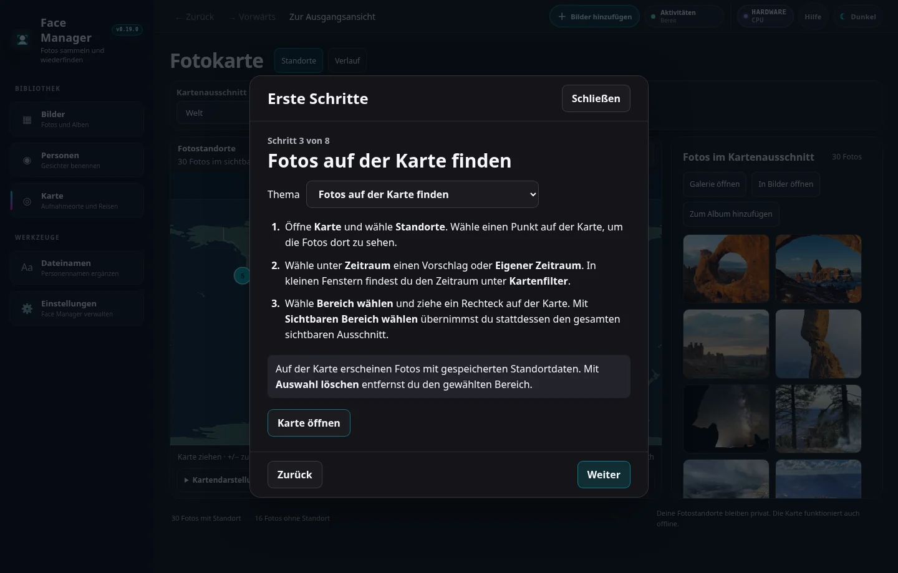

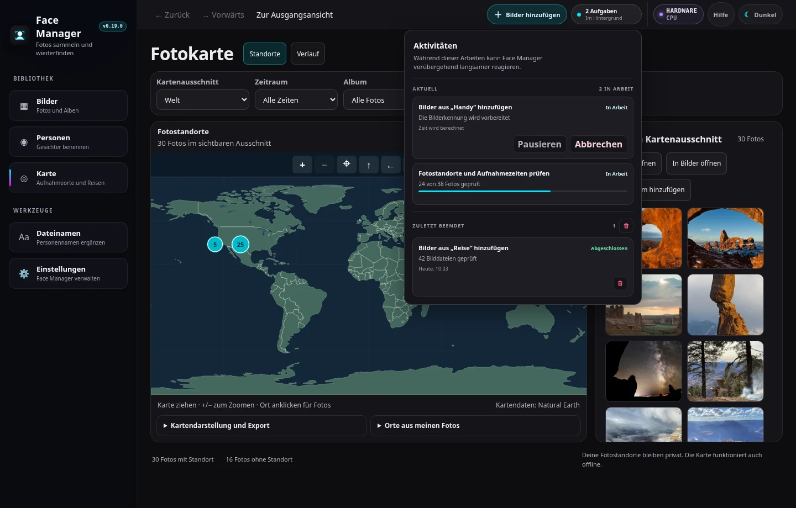

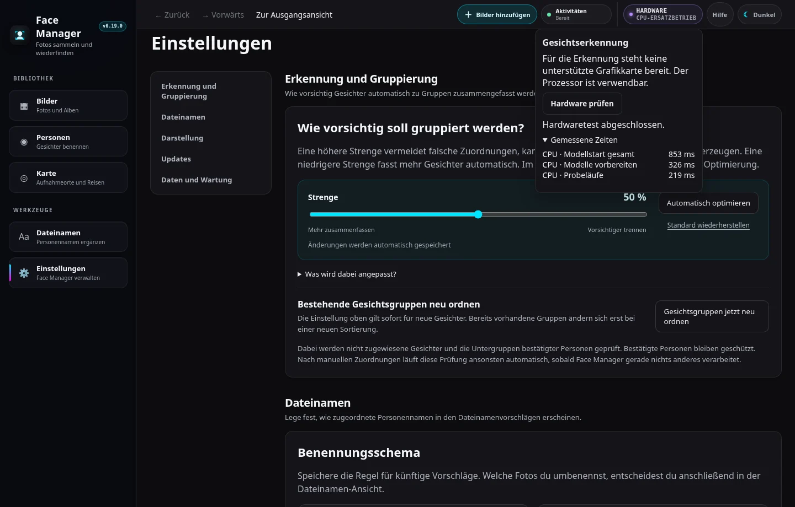

</details>

<details>
<summary>Einstellungen und gemeinsame Ordner</summary>

Unter **Einstellungen → Darstellung** kannst du **Hell** oder **Dunkel** wählen. **System** übernimmt die Einstellung deines Betriebssystems. Unter **Daten und Wartung** erstellst du eine Sicherung und stellst die Größe des lokalen Vorschau-Speichers ein.

**Gemeinsame Ordner** lassen sich in einer Entwicklervorschau für den Abgleich von Zuordnungen über eine eingerichtete Freigabe nutzen. [Stand und Einrichtung der Vorschau](docs/shared-library-design.md)

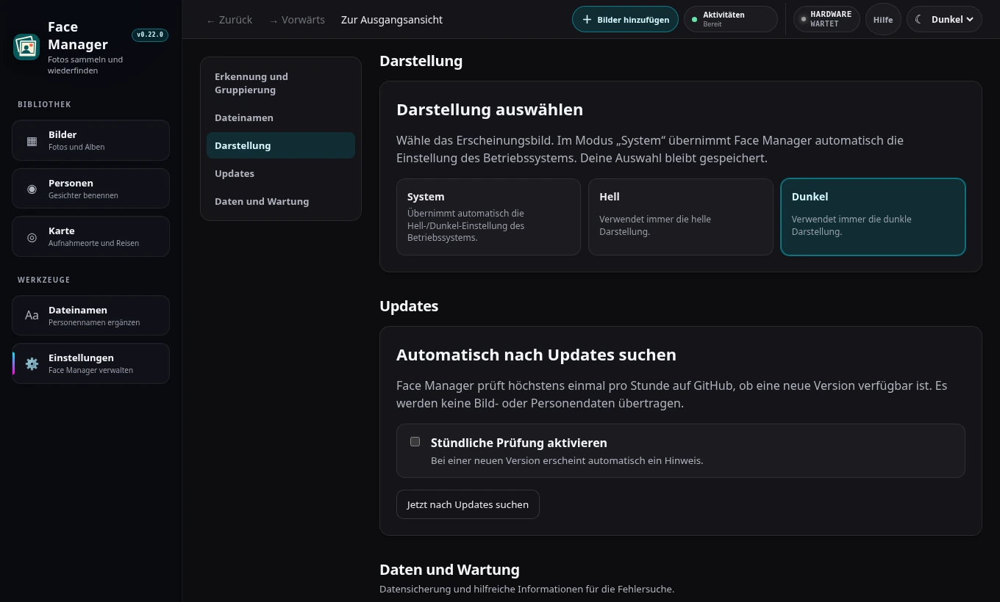


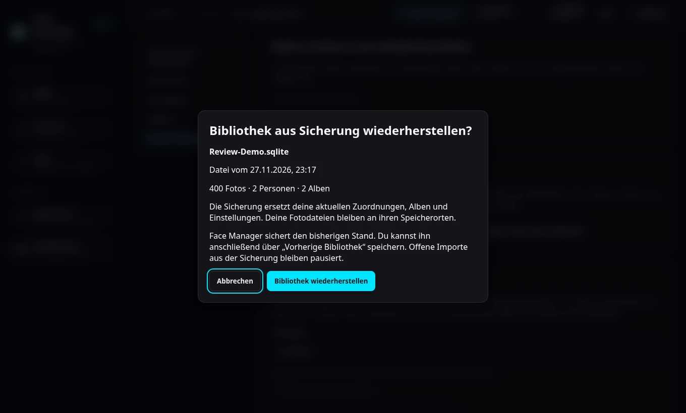

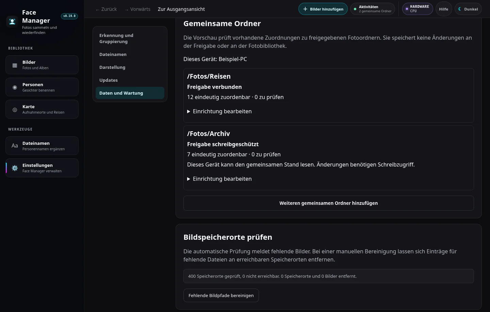

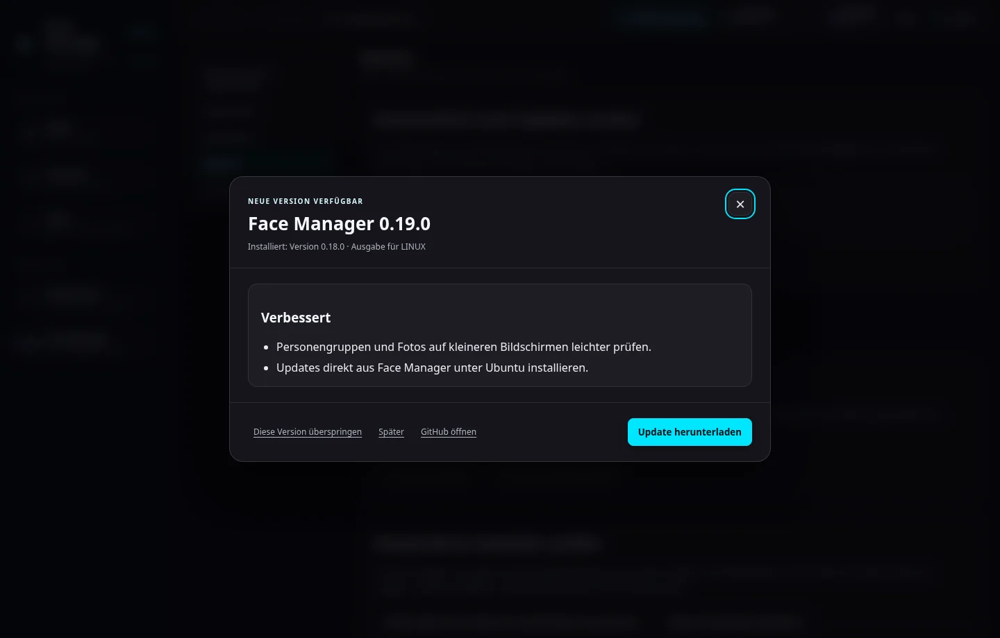

</details>

<a id="data-and-privacy"></a>

## Daten und Datenschutz

Die Fotoanalyse läuft auf deinem Gerät. Namen, Zuordnungen und Merkmale erkannter Gesichter speichert Face Manager in einer lokalen Bibliothek. Die Bibliothek verweist auf deine Fotoordner. Wenn du einen Ordner verschiebst, füge ihn am neuen Speicherort erneut hinzu.

Unter **Einstellungen → Daten und Wartung** kannst du die Bibliothek sichern oder eine frühere Sicherung wiederherstellen. Die Vorschau zeigt, wie viele Fotos, Personen und Alben in der gewählten Datei stehen. Nach der Bestätigung kannst du den vorherigen Stand herunterladen. Sichere deine Originalfotos separat.

Unter **Aussortierte Gesichter prüfen** findest du Hinweise aus früheren Sicherungen, falls ein eigentlich aussortiertes Gesicht wieder bei einer benannten Person erschienen ist. Du kannst auch eine eigene Sicherung derselben Bibliothek zum Vergleich hinzufügen. Übernimm nur Vorschläge, bei denen du das Gesicht wiedererkennst.

Karte, Reiseverlauf und Fotobuch-Export verwenden lokal mitgelieferte Karten- und Satellitendaten. Wenn du **Kartendetails online** einschaltest, fragt Face Manager beim Zoomen die benötigten Kartenkacheln bei EOX und OpenFreeMap ab. Die Anbieter erhalten den sichtbaren Kartenbereich und die IP-Adresse der Verbindung. Fotos, Foto-IDs und Aufnahmezeiten bleiben auf dem Gerät. Die Einstellung gilt für die laufende Sitzung. Die optionale Update-Suche fragt GitHub nach neuen Versionen. [Kartendaten und Quellen](frontend/src/components/map/world-land.LICENSE.md) · [Datenaustausch in der Vorschau für gemeinsame Ordner](docs/shared-library-design.md)

<a id="run-from-source"></a>

## Aus dem Quellcode starten

Für Ubuntu ab 22.04 und WSL2 richtet das Setup die Entwicklungsumgebung ein.

```bash
git clone https://github.com/KaiPressmar/face-manager.git
cd face-manager
./scripts/setup-dev.sh
```

Starte im Projektordner `./scripts/dev-backend.sh` und in einem zweiten Terminal `npm --prefix frontend run dev`. Die Entwicklungs-API auf Port 8000 ist für vertrauenswürdige Netze vorgesehen. [Anwendung öffnen](http://localhost:5173) · [API-Dokumentation](http://localhost:8000/docs) · [Entwicklung und Beiträge](CONTRIBUTING.md)

<a id="build-desktop-installers"></a>

<details>
<summary>Tests und Desktop-Installer</summary>

Führe `./scripts/check-all.sh` aus, um Änderungen zu prüfen. Baue Installationspakete mit `./packaging/windows/build-release.ps1` unter Windows oder `./scripts/package-linux.sh` unter Ubuntu 26.04. [Voraussetzungen und Release-Prozess](CONTRIBUTING.md) · [Build-Konfiguration](.github/workflows/release.yml) · [Plan für Karte, Alben und Aktivitäten](docs/plans/photo-map-and-activities.md)

</details>
